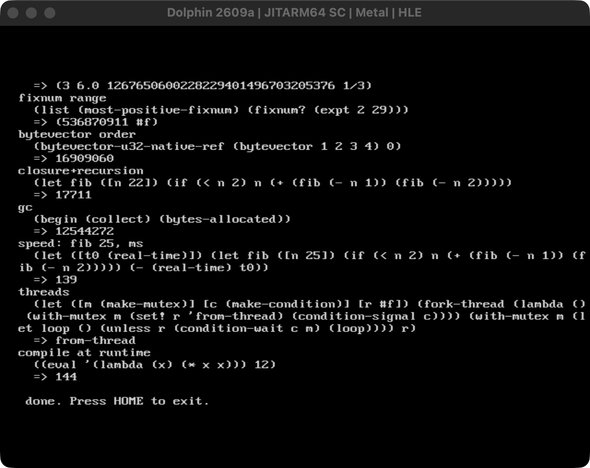
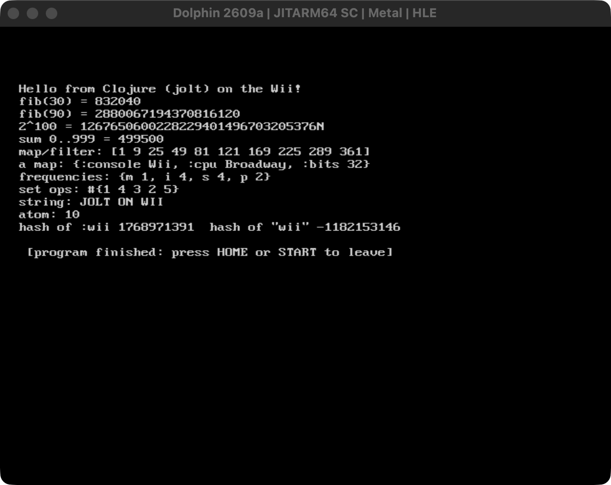
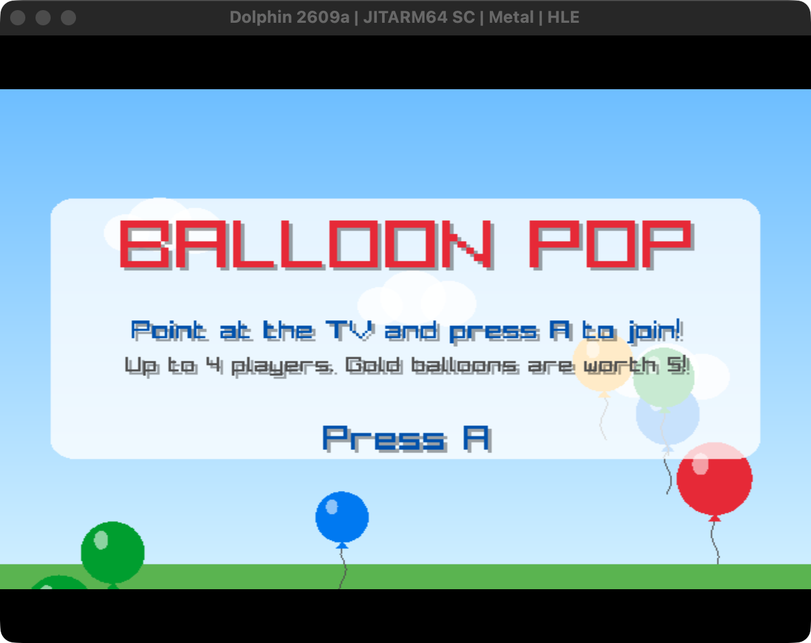
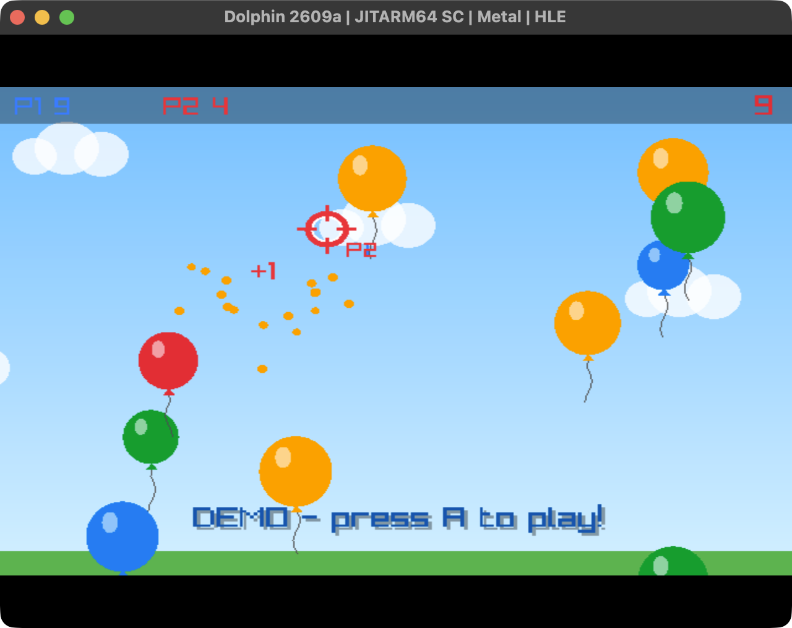

# wii-jolt

Programs for the Nintendo Wii we have at home, built from the tools we already
use: stock [raylib](https://www.raylib.com/) 6.0, [Chez Scheme](https://github.com/cisco/ChezScheme)
10.4.1 and Clojure through [Jolt](https://github.com/jolt-lang/jolt). Everything
compiles on a Mac with devkitPro's toolchain in Docker, and we test it in the
Dolphin emulator with its strict memory checking turned on.

<p>
  
  
  
</p>

*Left to right: raylib's SDL backend drawing through OpenGX, Chez Scheme's
portable bytecode running on the Wii's PowerPC, and a Clojure program compiled by
jolt whose output matches the Mac build line for line. All three are Dolphin
screenshots. None of this has run on the physical console yet, and that's the
next step.*

## Balloon Pop

<p>
  
  
</p>

Our first game for the kids. Point a Wiimote at the TV and press A to pop
balloons, with up to four players, 60-second rounds, gold balloons worth 5, and
a rumble on every pop. `bb play:balloons` opens it in Dolphin so you can try
it on the Mac with the mouse, and [Balloon Pop](docs/guide/balloon-pop.md) has
the rules and how it's built.

## What's here

| App | Size | What it shows |
|---|---|---|
| `examples/balloons` | 1.1 MB | Balloon Pop, a Wiimote pointer game (raylib + libogc's WPAD) |
| `examples/hello` | 1.1 MB | raylib 6.0, unmodified, at 60 fps over SDL2 and OpenGX |
| `chez-wii` | 4.5 MB | Chez Scheme booting from boot files baked into the program, with bignums, threads, runtime `eval` and a full collect |
| `jolt-hello` | 10.9 MB | Clojure: maps, sets, lazy seqs, atoms, bignums and Java-compatible hashes |

The interesting part is the bottom row. Chez has a big-endian 32-bit
portable-bytecode target (`tpb32b`) that had never been pointed at a real
machine, and jolt had never produced code for a 32-bit or big-endian one. Getting
there took a short patch to the Chez kernel, two small shims for gaps in libogc,
and a fix to how `jolt build` cross-compiles for 32-bit targets. The
[Jolt on the Wii](docs/guide/jolt-on-the-wii.md) page walks through each one.

## Quick start

```sh
bb doctor        # Docker, the devkitPPC image, Dolphin, jolt, Chez: what's missing
bb chez:setup    # one time: Chez 10.4.1 + the Wii patch, about 5 minutes
bb test          # Balloon Pop's rules, compiled and tested on the Mac
bb verify        # build everything, boot each app in Dolphin, check the output
bb sd            # gather everything into build/sd/apps for an SD card
```

`bb info` prints every task, grouped. `jolt info` works too, since jolt reads
the same `bb.edn`.

Copy `build/sd/apps` to the root of an SD card or USB drive and the apps show up
in the Homebrew Channel. [Running on your Wii](docs/guide/running-on-your-wii.md)
covers the console side, including what to check before trying it on the family
Wii.

## Documentation

- [Balloon Pop](docs/guide/balloon-pop.md): how to play, and how the game
  reads the Wiimotes
- [Getting started](docs/guide/getting-started.md): the toolchain, the build,
  and testing in Dolphin
- [Running on your Wii](docs/guide/running-on-your-wii.md): the Homebrew
  Channel, SD card layout, `wiiload`
- [raylib on the Wii](docs/guide/raylib-on-the-wii.md): the SDL2 + OpenGX route
  and the keyboard crash it hit
- [Chez Scheme on the Wii](docs/guide/chez-scheme-on-the-wii.md): the kernel
  patch, thread-local storage, the POSIX stubs
- [Jolt on the Wii](docs/guide/jolt-on-the-wii.md): the target pack, the 32-bit
  fixes, the console tee
- [Resources and links](docs/guide/resources.md): everything we read, with
  links
- [Roadmap](ROADMAP.md): what's next, starting with real hardware

`bb site:serve` builds the docs into a local site through
[docs-engine](https://github.com/jlt-commons/docs-engine) and serves it on
localhost.

## Layout

```
raylib-wii/     builds vendor/raylib as libraylib.a for the Wii, plus wii_shim.c
examples/       raylib apps: balloons (the game, with host tests), hello
chez-wii/       Chez kernel build, the chez test app, and the runtime objects
                that jolt-built programs link (console, TLS hooks, POSIX stubs)
jolt-hello/     a Clojure program, with its expected output
patches/        chez-wii.patch, applied to Chez v10.4.1 by scripts/setup-chez
scripts/        dkp (run in the devkitPPC image), wii-cc, dolphin-shot,
                setup-chez, make-pack, jolt-wii-build
vendor/raylib/  raylib 6.0 source, unmodified
```

## License

EPL-2.0, see [LICENSE](LICENSE). raylib is under its own zlib/libpng license,
and the full attribution list is in [NOTICE](NOTICE).
