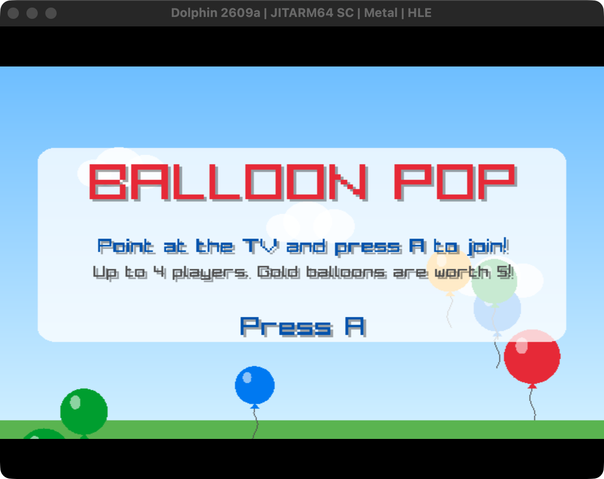
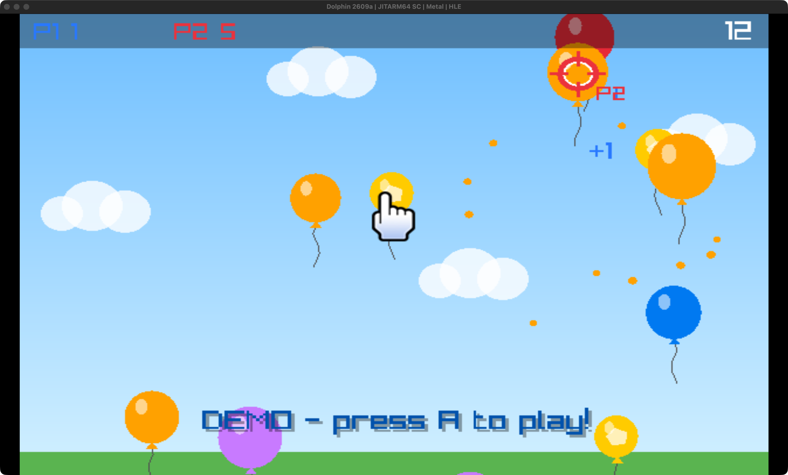
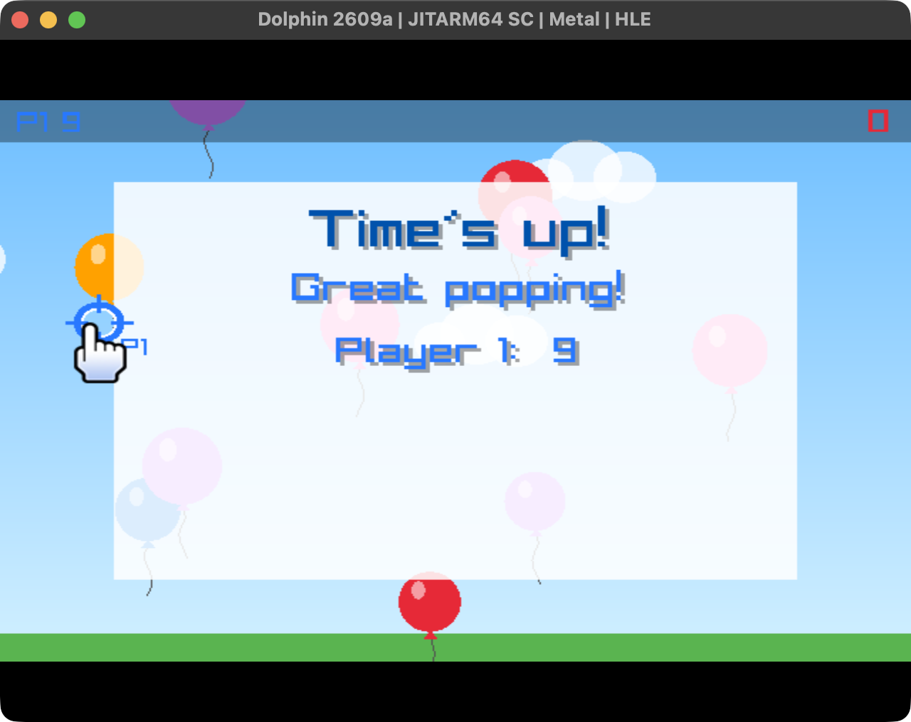
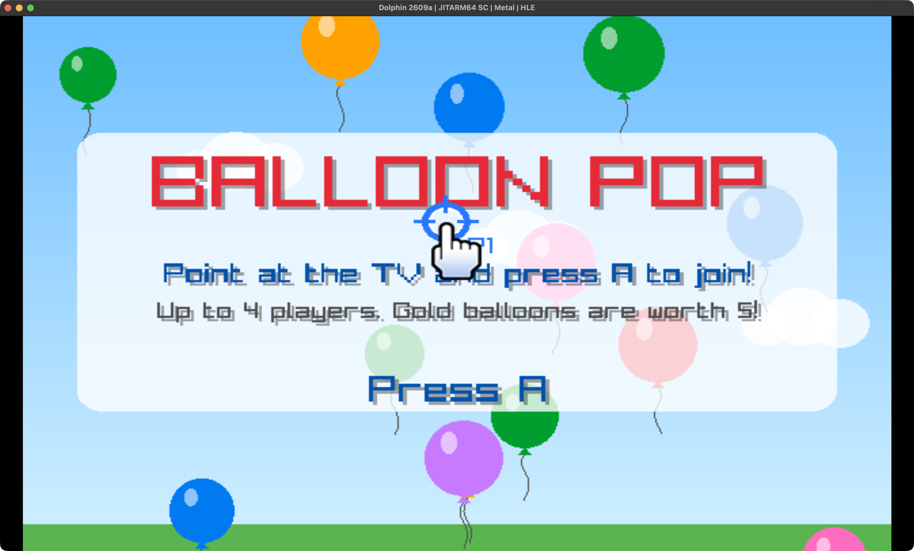
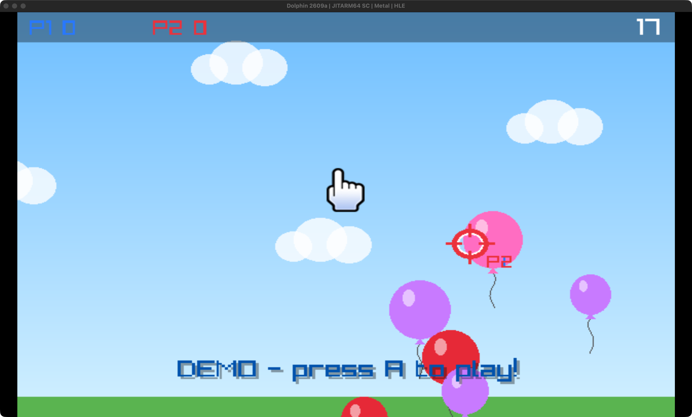
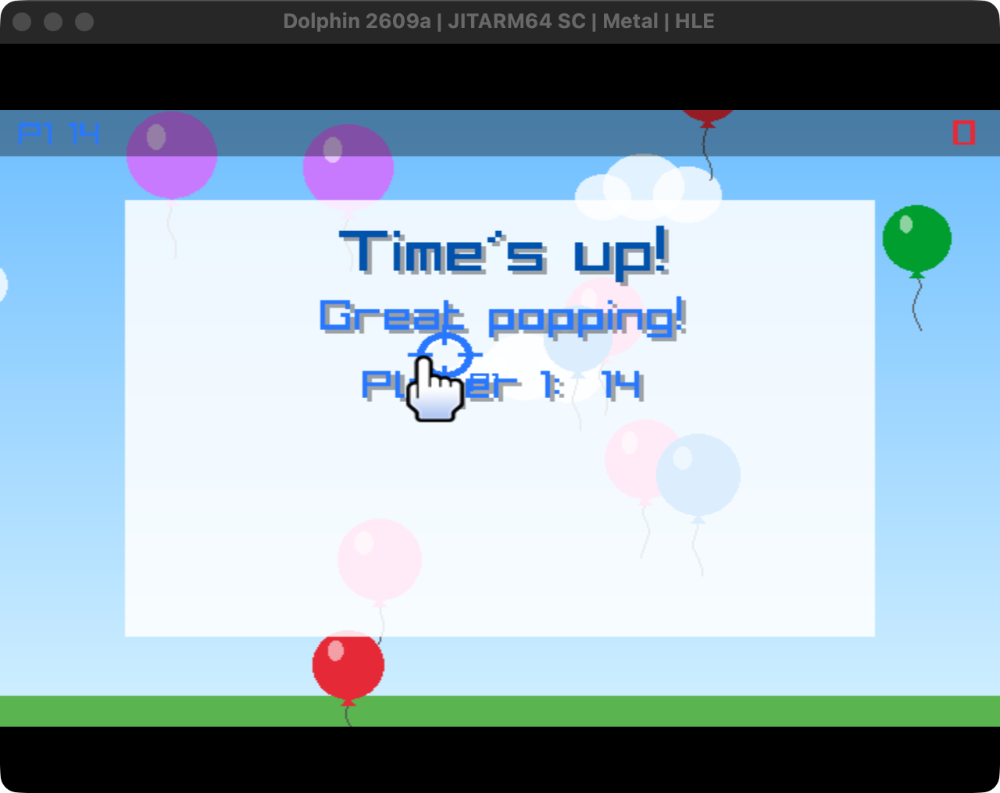
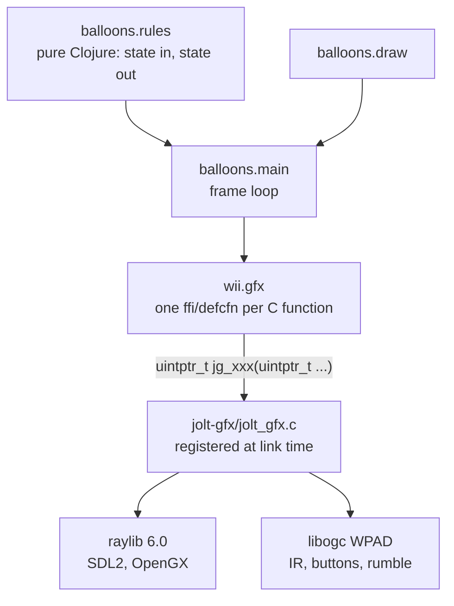

# Balloon Pop in Clojure

Balloon Pop is also written in Clojure, on jolt, and runs on the Wii through
the same pipeline as `jolt-hello`. The game plays. It also misses the 60 fps
budget on most frames, and this page records why, with numbers. Every number
here comes from Dolphin 2609a with MMU emulation on. Nothing has run on a
physical console, so treat them as Dolphin's, not the Wii's.

| Title | Play (robot demo) | Results |
|---|---|---|
|  |  |  |
|  |  |  |

The top row is the C game from [Balloon Pop](balloon-pop.md), the bottom row
the Clojure one. The rules and the drawing are the same on purpose.

## Trying it

```sh
bb build:jolt-balloons
bb run:jolt-balloons            # robot demo, prints the events
bb run:jolt-balloons-wiimote    # a scripted Wiimote plays a round
bb play:jolt-balloons           # you play, with the Mac's mouse as the pointer
bb compare:balloons             # C and Clojure side by side, one table
```

`bb play:jolt-balloons` works like `bb play:balloons`: left click is A, Return
is HOME. The Clojure game takes about 7 seconds to show its first frame.

## How it's built



The game is `jolt-balloons/src/balloons/{rules,draw,main}.clj`. `rules.clj` is
plain immutable maps and vectors: one function takes the old state and the
remotes' input and returns the new state, so it runs on the Mac under
`jolt -A:test`. `draw.clj` turns a state into raylib calls and `main.clj` runs
the loop and logs the same event lines the C game does, with a
`jolt-balloons: ` prefix.

`jolt-gfx/` is the glue. `wii.gfx` (`jolt-gfx/src/wii/gfx.clj`) declares one
`defcfn` per C function in `jolt-gfx/jolt_gfx.c`, and `wii.frame-stats` prints
the timing line both games emit every 120 frames.

### Why the glue looks the way it does

Each piece answers something the first spike hit.

- **Every C function is `uintptr_t jg_xxx(uintptr_t ...)`, at most 7
  arguments.** Chez on the Wii runs portable bytecode with no libffi, so it
  can only call shapes from a fixed table. A `:string` argument next to a
  `:uptr` failed with `foreign-procedure: protocol not supported (libffi
  unavailable)`. Strings go over as the address from `ffi/string->ptr`, and
  negative numbers go as two's complement and come back through `(int)`.
  `jolt-gfx/jolt_gfx.h` has the full rule.
- **Registration happens at link time.** There is no `dlsym` on the Wii, so
  `jolt_gfx.c` registers every function with `Sforeign_symbol` from inside
  `Sbuild_heap`'s init, and the graphics pack links with
  `-Wl,--wrap=Sbuild_heap` (`scripts/make-gfx-pack`).
- **SDL's `main` has to run first.** jolt generates its own `main`.
  `scripts/wii-cc-sdl` compiles with `-Dmain=SDL_main`, so devkitPro's SDL
  wrapper runs first and calls `WPAD_Init`. It is the same bug
  [Balloon Pop](balloon-pop.md#the-bug-the-first-test-missed-sdls-own-main)
  hit in C.
- **Values stay under 2^29.** A 32-bit Chez fixnum is 30 bits. The shim masks
  what it returns, and the IR pointer comes back biased by 4096
  (`JG_IR_BIAS`) so a pointer slightly off screen is not a negative number.

The graphics pack is the plain pack minus the text console, plus the shim,
raylib and SDL: `bb gfx-pack`. Whether to keep this link-time registration or
teach jolt's cross builds about `:jolt/native` is still open (see
`ROADMAP.md`).

## The measurement

The first Clojure draw was slow, so the work went into finding out why. The
raw numbers and every run are in `jolt-balloons/MEASUREMENTS.md`.

### 1. A busy frame

`balloons.stress` draws a busy frame: 4 players aiming, 24 balloons, 100
particles. That is 368 draw calls per frame. Steady state was a draw median of
about 253 ms and a work median of about 269 ms, against a 16.7 ms frame. Draw
was 94% of the work, about 0.69 ms per call.

### 2. Why there is no command buffer

The obvious fix is to batch the 368 calls into a buffer and cross once. Before
building it, `balloons.ffi-bench` (`bb run:jolt-ffi-bench`) timed the pieces.

| Operation | Per op |
|---|---|
| `defcfn` call, no arguments | 3.9 us |
| `defcfn` call, 5 fixnum arguments | 18.0 us |
| `ffi/write` of one `:int32` | 48.8 us |
| `write-array :int32`, per element | 89.0 us |
| `conj` onto a persistent vector | 22.4 us |

One `ffi/write` costs 2.7 times as much as a whole 5-argument call. A buffer
of 5 fields per shape would cost about 244 us per shape against 18 us for the
direct call. So the per-shape calls stay.

### 3. Where the time goes

Three builds of the same busy frame split the draw time:

| Part | Time per frame |
|---|---|
| Clojure compute | 232 ms |
| The FFI crossing, 368 calls | 7 ms |
| raylib and OpenGX | 24 ms |

Of the 252 ms draw, about 232 ms was Clojure computing the shapes. The
crossing and raylib together were about 31. The figures don't sum exactly (a
5% gap, probably from GC timing), but they are small next to 232. The first
guess, that the missing time sat in the C draw functions, was wrong.

### 4. The hot spot: `(long x)`

`balloons.draw-profile` timed single operations on the Wii. A keyword lookup
costs 2.4 us and `Math/sin` 11.7 us. `(long x)` on a double costs **135 us**.

`wii.gfx` cast every coordinate with `long`, which makes 1324 double casts in a
busy frame. On a 32-bit Chez the checked cast compares the double against
+-2^63, and those bounds are bignums. A `^double` hint changes nothing (135.6 us
against 135.5 us). `unchecked-long` skips the comparison and costs 26 us.

Switching the coordinate casts to `unchecked-long` took the draw from 252 ms to
60 ms, 4.2 times faster. The picture didn't change, and two tests pin that:
a golden test of the 1129 draw calls for 13 states
(`jolt-balloons/test/balloons/draw_test.clj`), and
`casts-agree-on-every-recorded-argument`, which checks that every double
argument those states draw gives the same value under both casts. One
behaviour differs for values outside the tested range: `unchecked-long`
saturates an out-of-range double and turns NaN into 0, where `long` throws.

### 5. The real game

The stress frame is a worst case. `bb compare:balloons` runs both real games
for a 45 second robot demo and for a scripted round (64.5 seconds for C, 70
for Clojure), drops each run's first summary line, and prints one table.

| | C, demo | Clojure, demo | C, round | Clojure, round |
|---|---|---|---|---|
| `.dol` size (bytes) | 1339808 | 14478048 | 1339808 | 14478048 |
| Summary lines used | 21 | 12 | 31 | 22 |
| Work median (us) | 3882 | 24167 | 3122 | 22711 |
| Work worst, max (us) | 5557 | 41086 | 5144 | 42474 |
| Frame worst, max (us) | 16671 | 61977 | 16672 | 61347 |
| Dropped frames, total | 0 | 1003 | 0 | 2173 |

Each summary line covers 120 frames, so the Clojure round dropped 2173 frames
across 22 summaries. A frame counts as dropped when its interval passes 20000
us. The Clojure game works through a frame in 23 to 24 ms (the two work medians
are 24167 and 22711 us) where C needs 3 to 4 ms. That is over the 16.7 ms
budget, and the dropped counts above are what was measured: the Clojure game
drops most frames in both runs, and C drops none. The `.dol` is about 14.48 MB.

Lines of code, from `wc -l`:

| | Lines |
|---|---|
| C game (`examples/balloons/{game.h,game.c,main.c}`) | 747 |
| Clojure game (`jolt-balloons/src/balloons/{rules,draw,main}.clj`) | 602 |
| Glue the Clojure game needs, C (`jolt_gfx.c`, `jolt_gfx.h`) | 262 |
| Glue the Clojure game needs, Clojure (`gfx.clj`, `frame_stats.clj`) | 131 |

The game itself is shorter in Clojure. The glue it needs is 393 lines on top
of that, and a second Clojure game could use it unchanged.

### 6. The cost of pure rules

The rules are pure on purpose: no mutable arrays, atoms or volatiles in
`balloons.rules`, even to win frames. That was a decision, and its price is
recorded here, not engineered away. One update of a real board takes about 6
us in C and about 4 ms in Clojure. On the busy stress frame the update takes
15.5 ms, just under a 16.7 ms frame, and the draw 60 ms after the cast fix, so
the draw, and the two together, are over budget.

Levers that remain, all estimates in `MEASUREMENTS.md`: a cheaper
double-to-fixnum truncation (a saving of 15 to 20 ms from a 48 ms draw), caching
C strings for static text (about 1 ms), and a sine lookup table (about 1.7
ms). None is done.

## What this taught us about jolt

- **The checked cast is slow on 32 bits.** `(long x)` on a double is 135 us
  because it compares with bignum bounds. Use `unchecked-long` where the value
  is known to be in range.
- **`ffi/write` is expensive.** One `:int32` write costs 2.7 times a whole
  5-argument call, so batching through memory loses to calling directly.
- **No libffi means a fixed table of call shapes.** Anything outside the table
  fails, and `:string` is one of them. That is why every shim function is
  `uintptr_t` in and out, with at most 7 arguments (`jolt-gfx/jolt_gfx.h`).
- **No `dlsym`, so registration is link-time.** The `-Wl,--wrap=Sbuild_heap`
  trick registers the shim's functions as the heap builds.
- **SDL's `main` must run first.** `-Dmain=SDL_main` renames jolt's `main`, so
  SDL's wrapper can initialise the Wiimotes.
- **The GC trips too late.** jolt sizes its allocation window at 16 MB, and
  the first runs died with "out of memory". The shim's constructor sets
  `JOLT_GC_TRIP_BYTES` to 2097152.
- **Fixnums are 30 bits.** Anything above 2^29 is a bignum. Colours
  (`0xRRGGBBAA`) are bignums, which costs about 2 us per call, and the IR
  position is biased by 4096 so an off-screen pointer isn't negative.
- **The heap is nearly full before the program starts.** A jolt program's
  runtime holds about 41 MB live on the Wii (58 MB at the boot peak) in a heap
  of about 60 MB: what MEM1 has left after the `.dol` loads, plus MEM2. What
  looked like a `.dol` size cliff at about 14.76 MB was that heap running out;
  a build a little bigger, or one that keeps a little more data, dies with
  "out of memory" before its first line. The shim wraps `malloc` in the pack's
  link and serves the overflow from what libogc's sbrk strands in both arenas
  (3.4 MB), and prints the heap's state at `jg_init` to Dolphin's log. The
  numbers are in `MEASUREMENTS.md`.

## What's next

The real console, first. Then the open decision: keep the link-time glue or
teach `jolt build --target` about `:jolt/native` archives. See `ROADMAP.md`.
