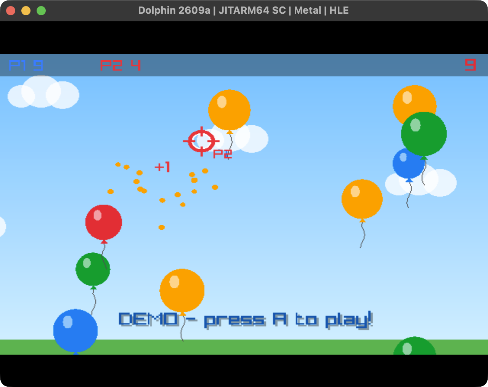

# Balloon Pop



Our first game for the kids. Balloons float up from the grass, you point the
Wiimote at the TV and press A to pop them, and every pop gives a little rumble.
Gold balloons are faster and smaller, and they're worth 5.

## How to play

1. Start **Balloon Pop** from the Homebrew Channel.
2. Everyone who wants to play points at the TV and presses **A**. The first
   press starts a 3-2-1 countdown, and anyone else can still join by pressing
   A before it ends. Up to four players, each with their own coloured pointer:
   blue, red, green, yellow.
3. Pop as many balloons as you can in **60 seconds**. **A** or **B** pops
   whatever is under your pointer.
4. The results screen shows everyone's score and the winner. Press A to go
   back to the title.

**HOME** quits back to the Homebrew Channel at any time.

If nobody touches anything on the title screen for 8 seconds, two robot
players put on a 20-second demo. Pressing A stops it.

## Playing it on the Mac first

```sh
bb play:balloons
```

This opens the game in Dolphin. Dolphin's emulated Wiimote follows the Mac's
mouse: the pointer goes where the mouse is, **left click is A**, right click is
B, and **Return is HOME**. Those are Dolphin's own defaults, written out by
the `play` profile in `scripts/dolphin-auto-wiimote`. A person hasn't played a round
this way yet (the scripted test below has), so if the pointer doesn't show up,
Dolphin's controller settings are the first place to look.

## Putting it on the Wii

```sh
bb build:balloons
bb sd
```

Then copy `build/sd/apps/balloons/` to `apps/balloons/` on the SD card or USB
drive. The Wii needs its sensor bar connected for pointing, the same as any
pointer game.

## How it's built

The game is two halves, so the rules can be tested on the Mac.

- **`examples/balloons/game.c`** has the rules and nothing else: balloons,
  spawning, scoring, the title → countdown → play → results flow, the demo
  robots, confetti. It doesn't include raylib or any Wii header. `bb test`
  compiles it with the Mac's `cc` and runs 45 checks from
  `examples/balloons/test/test_game.c`: joining, popping, gold scoring, the
  round timer, ties, the results-screen lock, and the demo.
- **`examples/balloons/main.c`** is the Wii half: reading the Wiimotes,
  drawing with raylib, rumble, and a one-line event log.

### Wiimote input

The game reads the remotes through `examples/common/wiimote.c`, shared with
the other games, rather than through SDL, which merges every remote's pointer
into one mouse. [Wiimote input](wiimote-input.md) covers the module. Balloon
Pop uses three things from it: `ir_valid`, `ir_x`, `ir_y` for the pointer,
A or B in `pressed` to pop, and `wiimote_rumble` for an eighth of a second per
pop (a quarter for gold).

### The bug the first test missed: SDL's own `main`

The first version of this game passed every check and would have done nothing
on the Wii. The checks only watched the robot demo, and the robots never touch
a remote.

devkitPro's SDL for the Wii runs its own `main` (`SDL_wii_main.c`) before the
app's. That wrapper calls `WPAD_Init()`, hooks the power and reset buttons,
and mounts the SD card, then calls the app's code as `SDL_main`. A raylib app
defines a plain `main`, so the wrapper was never linked, and `WPAD_Probe`
answered `WPAD_ERR_NO_CONTROLLER` for every remote. The fix is SDL's usual
convention, one include at the top of `main.c`:

```c
#include <SDL2/SDL_main.h>   // our main() becomes SDL_main; SDL's main runs first
int main(int argc, char *argv[])
```

`examples/hello` had the same problem, which is why it only ever reported a
GameCube pad.

### Checking it without anyone holding a Wiimote

`bb verify` plays Balloon Pop twice in Dolphin, both times with MMU emulation
on.

**The robot demo.** Boot, wait 20 seconds, and require `balloons: mode demo`
followed by at least three pops. That covers drawing, the game loop and the
rules.

**A scripted Wiimote** (`bb run:balloons-wiimote`). The `pointer` profile of
`scripts/dolphin-auto-wiimote` makes Dolphin's emulated Wiimote 1 play by
itself:

```ini
Buttons/A = timer(0.25)                         ; press A four times a second
IR/Right = sin(timer(5) * 6.2832) * 0.6         ; sweep the pointer left
IR/Left = 0 - sin(timer(5) * 6.2832) * 0.6      ; and right across the middle
```

The check requires the remote to join (`mode countdown`), the round to start
(`mode play`), and player 1 to pop at least one balloon during play. That covers
the WPAD path end to end: SDL's `WPAD_Init`, the IR pointer, A-press detection
and scoring. It doesn't touch the Mac's real mouse.

One early run popped nothing at all. We blamed the pointer sweep at the time,
which also went up and down then, and kept it at mid-height after that. The
real cause was more likely the one Shake Race found later: Dolphin ignores
input while its window isn't focused, which `dolphin-shot` now turns off. See
[Wiimote input](wiimote-input.md).

What only the console can tell us: whether the real sensor bar and remotes
behave like Dolphin's, whether the rumble feels right, and whether four remotes
at once each keep their own pointer.

### An open question: one hang at boot

In one `bb verify` run, right after the switch to SDL's `main`, the game stopped
during raylib's start-up, just before SDL's video init, and never opened a
window. It didn't happen again in the next eight boots. SDL's wrapper now also
reloads IOS and mounts the SD card at start-up, which is new work that could be
involved, but nothing has shown that yet. Watch for a black screen on the first
hardware runs.

## Ideas for next time

- Sound: a pop, a countdown beep, a fanfare. libogc has ASND for this.
- Shake the Wiimote to pop every balloon near your pointer, once per round.
- Balloons the kids draw themselves, loaded from the SD card.
- A two-team mode for when four people are playing.
