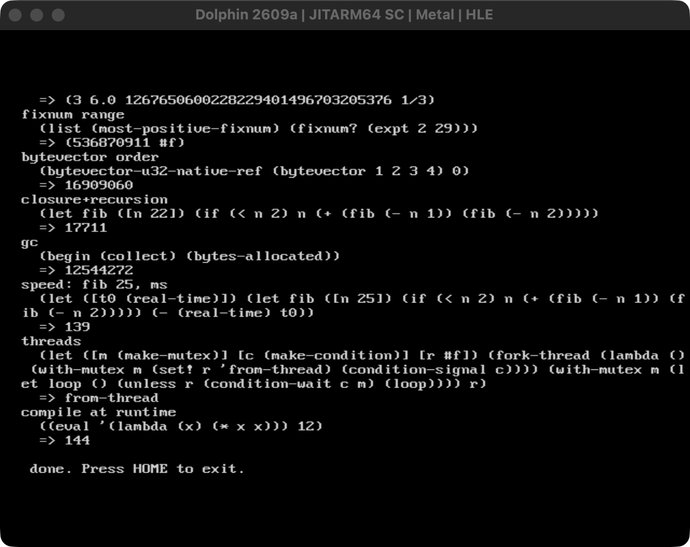

# Chez Scheme on the Wii



Chez Scheme normally compiles to native machine code, and it has a PowerPC
backend. That backend targets Linux and macOS, though, and it generates code at
run time. A Wii has neither an OS nor a reason to want a JIT. Chez's
**portable bytecode** targets fit much better: the compiler emits bytecode for an
abstract machine, and a C interpreter in the kernel runs it. The kernel is
plain C, so devkitPPC can compile it.

The machine type we use is `tpb32b`:

| | |
|---|---|
| `t` | threaded (Chez's thread support compiled in, which jolt needs) |
| `pb` | portable bytecode |
| `32` | 32-bit words and pointers |
| `b` | big-endian, matching the Wii's PowerPC |

`tpb32b` is listed in Chez's `s/cmacros.ss`. As far as we can tell, nobody had
run it on big-endian hardware before. raylib-ios runs jolt on `tpb64l` for a
similar reason (iOS forbids generating code at run time), and jasalt's WASM
experiment runs it on `tpb32l`.

## Building it

```sh
bb chez:setup    # once
bb build:chez
```

`scripts/setup-chez` clones `~/dev/ChezScheme` locally into `.work/ChezScheme`,
checks out `v10.4.1` (the Chez that jolt is built on), applies
`patches/chez-wii.patch`, builds a Mac Chez, and then runs
`make bootquick XM=tpb32b`. That last step produces the `tpb32b` boot files,
`petite.boot` (2.1 MB) and `scheme.boot` (1.0 MB), plus the `scheme.h` and
`equates.h` the kernel compiles against.

`chez-wii/Makefile` then compiles the kernel's C files with devkitPPC into
`libkernel.a` and links the test app. The boot files go into the `.dol` itself
through `.incbin` in `boot_data.S`, and `main.c` hands them to Chez with
`Sregister_boot_file_bytes`, so no filesystem is involved.

## The kernel patch

`patches/chez-wii.patch` adds 84 lines to five files, all under `#if
defined(__wii__)`:

- **`version.h`** gets a `__wii__` OS branch modelled on the existing
  `__EMSCRIPTEN__` one: `malloc` instead of `mmap`, no dynamic loading, no
  curses or X11, and newlib's `struct stat` time fields. It also adds `__wii__`
  to the big-endian architecture test. That test checks `__powerpc__`, which
  devkitPPC doesn't define (it defines `__PPC__`, `PPC` and `__wii__`), so
  without the addition Chez would silently assume little-endian.
- **`types.h`**: newlib has `setjmp`/`longjmp` but not the underscore-prefixed
  variants.
- **`stats.c`**: newlib's `struct tm` has no `tm_gmtoff` or `tm_zone`. The Wii
  clock has no time zone anyway, so it reports UTC.
- **`schsig.c`**: libogc has no POSIX signals, so the handler setup is skipped.
- **`expeditor.c`**: the expeditor is the REPL line editor, and it needs a
  terminal. It's compiled out, but `scheme.boot` still binds its C entry points
  when it loads, so the patch registers all thirty names against one stub that
  answers "not a terminal".

## Thread-local storage

With the patch, Chez linked and then stopped at startup with "Function not
implemented". The failing call was `pthread_key_create`.

devkitPro's newlib does provide pthreads, implemented in `libsysbase` on top of
hooks a platform library is meant to fill in. libogc 3.2.1 fills in the thread
and condition variable hooks but not the four TLS ones (`__syscall_tls_create`,
`_set`, `_get`, `_delete`), or `__syscall_thread_detach`. They're weak symbols,
so nothing fails at link time, and `pthread_key_create` just returns `ENOSYS`.

`chez-wii/ogc_tls.c` provides them: a fixed table of 64 threads by 32 keys,
looked up by `LWP_GetSelf()`, with interrupts disabled around each access. It's
deliberately simple, and that comes with limits:

- Rows aren't freed when a thread exits, and libogc reuses thread handles, so a
  new thread can briefly see an old thread's values. Chez sets its own key at
  the start of every thread it creates, so this doesn't affect it.
- Destructors are recorded but never run.
- `pthread_detach` is a no-op.

## POSIX stubs

The kernel also references `fork`/`exec`-style process calls, signals,
`getpwnam`, `iconv` and `getrusage`, none of which libogc has.
`chez-wii/posix_stubs.c` provides them. Most return an error, so Scheme code
that reaches one gets an ordinary exception. `getrusage` returns wall-clock time
as CPU time, because Chez reads it at startup to set up `cpu-time`.

## What works

`chez-wii/main.c` evaluates a list of expressions, all through Scheme's own
reader and `eval`. In Dolphin with MMU emulation on:

```
(scheme-version)                        => "Chez Scheme Version 10.4.1"
(machine-type)                          => tpb32b
(list (+ 1 2) (* 1.5 4) (expt 2 100) (/ 1 3))
                                        => (3 6.0 1267650600228229401496703205376 1/3)
(list (most-positive-fixnum) (fixnum? (expt 2 29)))
                                        => (536870911 #f)
(bytevector-u32-native-ref (bytevector 1 2 3 4) 0)
                                        => 16909060
(begin (collect) (bytes-allocated))     => 12544272
fib 25, ms                              => 139
threads (mutex + condition variable)    => from-thread
((eval '(lambda (x) (* x x))) 12)       => 144
```

`16909060` is `#x01020304`, so bytes are read in big-endian order. The fixnum
ceiling is 2^29 - 1, as on any 32-bit Chez. `fib 25` makes 242,785 calls, so
139 ms is about 1.7 million calls a second on a 729 MHz CPU, assuming Dolphin's
timing is close to the console's.

## Output on the TV and in the log

The test app prints every line twice: to the TV through libogc's text console
(stdout), and to the debug UART (stderr), which Dolphin logs. Calling
`SYS_STDIO_Report(true)` would send stdout to the UART *instead* of the TV, and
the screen would stay black on a real Wii, so the app uses
`SYS_STDIO_Report(false)` and writes to both itself.
