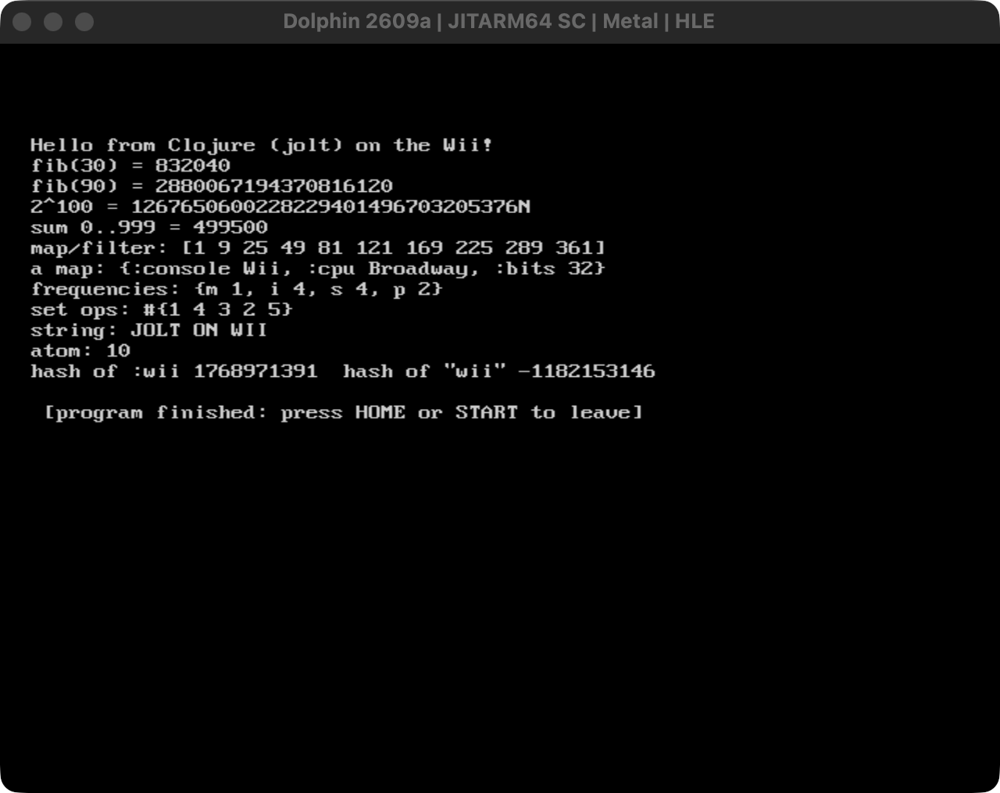
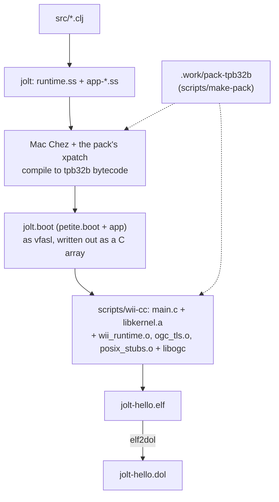

# Jolt on the Wii



jolt compiles Clojure to Chez Scheme, and `jolt build --target <machine>`
already cross-compiles for any Chez machine it has a "target pack" for. Once
Chez ran on the Wii, the question was whether that pipeline would carry a
Clojure program across too. It does, after two fixes to assumptions jolt makes
about 32-bit machines.

```sh
bb build:chez         # also builds the runtime objects jolt programs link
bb pack               # .work/pack-tpb32b
bb build:jolt-hello
bb run:jolt-hello
```

`jolt-hello/src/hello/core.clj` exercises the parts of Clojure most likely to
break on a new machine: long and bignum arithmetic, persistent maps and sets,
lazy sequences, string functions, atoms, and `hash`, whose values jolt pins to
the JVM's. Its output in Dolphin matches the Mac build byte for byte, and
`bb verify` checks that against `jolt-hello/expected-output.txt`.

## How the build works



`jolt build --target tpb32b --target-pack <pack>`:

1. Emits the jolt runtime and the app as Chez source (`runtime.ss`,
   `app-*.ss`), the same as a native build.
2. Starts a fresh **Mac** Chez, `(load ...)`s the pack's `xpatch` (Chez's cross
   compiler for `tpb32b`), and compiles everything to `tpb32b` bytecode.
3. Combines the pack's `petite.boot` and the compiled code into one `jolt.boot`,
   converts it to vfasl (9.4 MB for jolt-hello), and writes it out as a C array.
4. Links a generated `main.c` against the pack's `libkernel.a` using
   `$JOLT_TARGET_CC` and the flags in the pack's `link-libs`.

`scripts/make-pack` assembles the pack from `.work/ChezScheme` and
`chez-wii/build`. `scripts/wii-cc` is `$JOLT_TARGET_CC`: devkitPPC in Docker,
with the Wii machine flags added. `link-libs` names three objects from
`chez-wii` ahead of the libogc libraries:

- `wii_runtime.o`: a constructor that brings up video and the text console
  before jolt's `main` runs, tees stdout to the TV and the debug UART, and
  waits for HOME or START at exit so the output stays on screen.
- `ogc_tls.o` and `posix_stubs.o`: the same thread-local storage hooks and
  POSIX stubs the Chez test app uses (see
  [Chez Scheme on the Wii](chez-scheme-on-the-wii.md)).

`scripts/jolt-wii-build` runs `jolt build`, then `elf2dol`, then lays out
`build/sd/apps/<name>/`.

## Fix 1: the hash engine picked the 64-bit arm

The first run died during runtime init:

```
Exception: variable murmur3-seed is not bound
```

jolt's hash engine (`host/chez/hasheq.ss`) has two versions of its arithmetic.
On a 64-bit Chez every 32-bit hash value is a fixnum, so it uses unchecked
`#3%fx` operations. On a 32-bit Chez they can be bignums, so it uses generic
ones. `define-width-op` picks between them **when the code is expanded**, by
asking `(fixnum? #xFFFFFFFF)`. Its own comment says the catch:

> The test runs on the COMPILING Chez, which for a native build is the target.
> Cross-compiling to a target narrower than the host would have to consult the
> target's fixnum width here instead.

A cross build compiles on the 64-bit Mac, so the Wii got the 64-bit arm, and
unchecked fixnum operations on bignums give garbage rather than an error. jolt
already has an override for testing the narrow arm on 64-bit machines,
`JOLT_NARROW_HASH=1`, and setting it gets past init.

## Fix 2: checked fx operations on int-sized values

The next run failed with:

```
Exception in fx>=?: -2147483648 is not a fixnum
```

This one is in jolt's CHANGELOG entry for #801, which fixed the hash engine for
32-bit Chez: "Other host code still applies checked `fx` ops to int-width values,
which raise rather than corrupt." A grep of the generated runtime finds about a
dozen, for example:

```scheme
(if (and (fx>=? k -2147483648) (fx<=? k 2147483647)) k (int32-low k))
(if (fx>=? i #x80000000) (fx- i #x100000000) i)
```

On a 32-bit Chez the fixnum ceiling is 2^29 - 1, so `-2147483648` isn't a
fixnum and the check raises.

The fix replaces the checked `fx` operators (`fx+`, `fx>=?`, `fxand` and the
rest) with their generic equivalents for this compile. Generic and fx
operations agree whenever the arguments are fixnums, so code that was already
correct behaves the same. The explicit `#3%fx` primitives in the hash engine
aren't touched, and with fix 1 those are on the narrow arm anyway.

## Where the fixes live

There are two copies, and they do the same thing.

**In this repo**, for the installed jolt: the pack's `xpatch` is a small source
file, `chez-wii/xpatch-narrow.ss`, which loads the real cross patch
(`xpatch.chez`) and then defines the fx-to-generic aliases. jolt `(load ...)`s
whatever file is at `<pack>/xpatch`, so this needs no jolt changes.
`scripts/jolt-wii-build` sets `JOLT_NARROW_HASH=1`.

**In jolt itself**, on a local branch `feat/wii-tpb32b` in a worktree of
`~/dev/jolt` (not pushed anywhere). `build.ss` gains `bld-narrow-target?`,
which recognises the i3, arm32, armv7, ppc32 and pb32 machine families. For
those targets the generated compile script sets `JOLT_NARROW_HASH` and defines
the same aliases right after loading the xpatch. Native builds and 64-bit cross
builds generate exactly the script they did before. Tested both ways: a Wii
build from the branch with a plain pack and no environment variable matches
the Mac output, and a native macOS build from the branch is unchanged.

Once a jolt release carries the branch's change, the pack can go back to the
plain `xpatch` and the environment variable can go away.

## The console tee, and a libogc surprise

The first jolt-hello screenshot showed only the last line of output, with a
stray character from a longer line under it. The output in Dolphin's log was
fine. Logging every write showed jolt sending clean `\n`-terminated lines, so
something between the tee and the screen was changing them.

It turned out to be libogc's UART writer. `WriteUARTN` in
`libogc/exi.c` (line 1038 in 3.2.1) rewrites every `\n` to `\r` *in the
caller's buffer* before sending it, even though the devoptab `write_r`
signature passes the buffer as `const char *`. The tee wrote to the UART first,
so the console then got only `\r`s, and every line went back to column 1 of the
same row.

`wii_runtime.c` now writes to the console first and gives the UART its own
copy of the bytes. Anything else that sends a buffer to `SYS_STDIO_Report`'s
writer and then reuses it will hit the same thing.

## Size

| | |
|---|---|
| `jolt.boot.vfasl` embedded in the program | 9.4 MB |
| `jolt-hello.dol` | 10.9 MB |
| Wii MEM1, where a `.dol` loads | 24 MB |
| Wii MEM2 | 64 MB |

jolt drops the compiler from the image when the program never calls `eval` at
run time ("dropping compiler image" in the build log), which keeps this
manageable. A program that needs `eval` on the console would carry
`scheme.boot` as well.
