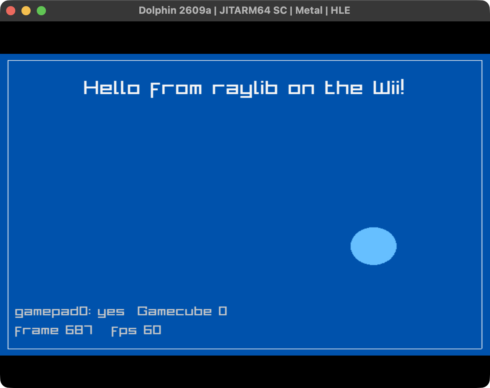
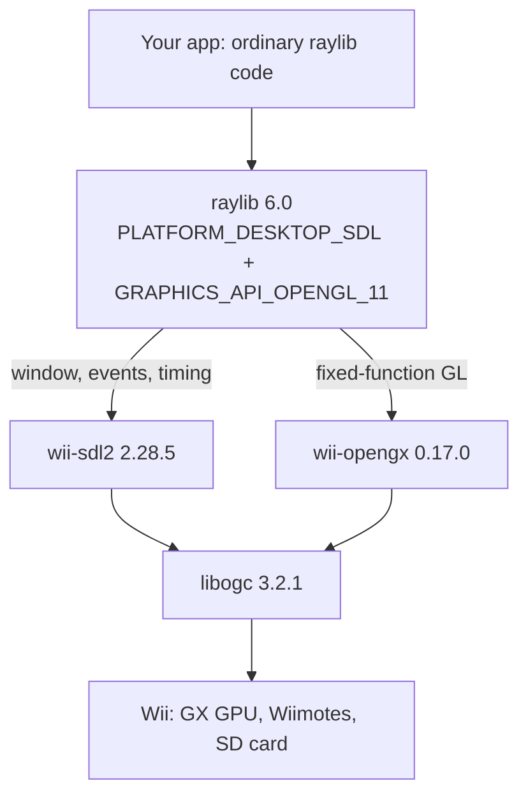
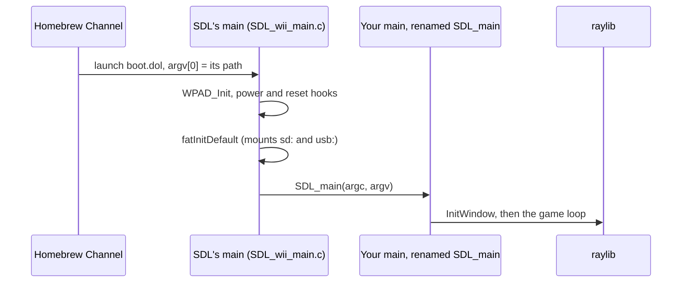

# raylib on the Wii



Stock raylib 6.0 runs on the Wii with no source changes. The trick is that
devkitPro already ships the two layers raylib needs underneath it.

## The stack

```
examples/hello/main.c          ordinary raylib code
vendor/raylib (6.0)            PLATFORM_DESKTOP_SDL + GRAPHICS_API_OPENGL_11
wii-sdl2 2.28.5                windows, input, timing on libogc
wii-opengx 0.17.0              OpenGL 1.x implemented over the Wii's GX GPU
libogc 3.2.1                   the Wii's system library
```



raylib picks its platform and its renderer at compile time. Its SDL platform
(`rcore_desktop_sdl.c`) asks SDL for a window and a GL context, and its OpenGL
1.1 renderer only uses fixed-function GL, which is what OpenGX implements. At
startup raylib reports:

```
INFO: GL: OpenGL device information:
INFO:     > Vendor:   opengx
INFO:     > Renderer: libogc
INFO:     > Version:  1.5
INFO: PLATFORM: DESKTOP (SDL2): Initialized successfully
```

`raylib-wii/Makefile` compiles `rcore`, `rshapes`, `rtextures`, `rtext` and
`rmodels` into `libraylib.a`. `raudio` is left out for now. raylib's audio
goes through miniaudio, and we haven't tried building it against libogc yet.

The one build change: raylib bundles a Windows `dirent.h` under
`src/external/`, so putting `external/` on the include path makes it shadow
newlib's real one and the build fails looking for `io.h`. raylib's own includes
already name `external/...` explicitly, so the fix is to leave that directory
off the include path.

I found no earlier raylib port for the Wii. The pieces were all there, and it
looks like nobody had joined them up.

## The keyboard crash

The first run looked fine in Dolphin, but with MMU emulation on it crashed
every frame with a null read inside libogc's thread queue. The stack, decoded
with `addr2line`:

```
KEYBOARD_GetEvent        libwiikeyboard/keyboard.c:637
OGC_PumpKeyboardEvents   SDL2-2.28.5/src/video/ogc/SDL_ogckeyboard.c:32
SDL_PumpEventsInternal   SDL_events.c:927
SDL_WaitEventTimeout     SDL_events.c:1097
PollInputEvents → EndDrawing → main
```

SDL's video init calls `KEYBOARD_Init(NULL)` and ignores what it returns. When
that init fails early (`USB_Initialize` or `USBKeyboard_Initialize` not
returning `IPC_OK`, which is what happens in Dolphin), libwiikeyboard skips
`__lwp_queue_init_empty(&_queue)`. SDL still calls `KEYBOARD_GetEvent` every
frame, and that walks a queue that was never set up.

libogc's `master` has the same code, checked 2026-11-03.

`raylib-wii/wii_shim.c` fixes it at link time, without patching either library.
The app links with `-Wl,--wrap=KEYBOARD_Init -Wl,--wrap=KEYBOARD_GetEvent`, and
the shim remembers whether init succeeded:

```c
s32 __wrap_KEYBOARD_GetEvent(keyboard_event *event)
{
    if (!kbd_ready) return 0;
    return __real_KEYBOARD_GetEvent(event);
}
```

One linking detail: the shim is passed as an object file
(`raylib-wii/build/wii_shim.o`), not as a member of `libraylib.a`. The
`__wrap_` symbols are only referenced from SDL, which comes later on the link
line, so an archive member would never get pulled in.

Whether `KEYBOARD_Init` also fails on a real Wii with no USB keyboard attached
is one of the things to check on hardware. The shim is harmless either way.

## SDL's main wrapper (needed for Wiimotes)

devkitPro's SDL for the Wii brings its own `main` (`src/main/wii/SDL_wii_main.c`
in their SDL fork). It reloads the preferred IOS, calls `WPAD_Init()`, hooks the
power and reset buttons, starts the USB mouse and mounts the SD card, then calls
the application as `SDL_main`. SDL's joystick code relies on that: it says
"We don't call WPAD_Init() here, since it's already been called by SDL_main".



A raylib app defines its own `main`, so it has to opt in with SDL's standard
include, or the Wiimotes never initialise:

```c
#include "raylib.h"
#include <SDL2/SDL_main.h>    // renames main to SDL_main

int main(int argc, char *argv[])
```

`examples/hello` and `examples/balloons` both do this. We found it through
Balloon Pop, see [Balloon Pop](balloon-pop.md).

## Writing your own raylib app

Make a directory next to `hello`, put a `main.c` (and optionally a `meta.xml`)
in it, then:

```sh
scripts/dkp make -C examples APP=myapp
```

A few Wii-specific notes:

- The screen is 640x480. `InitWindow(640, 480, ...)` matches it.
- Include `<SDL2/SDL_main.h>` and use `int main(int argc, char *argv[])`
  (see above), or no Wiimote will ever connect.
- For the Wiimote pointer, tilt or shake, read the remotes with libogc's WPAD
  through `examples/common/wiimote.c`, the way the games do. SDL merges every
  remote's pointer into one mouse. See [Wiimote input](wiimote-input.md).
- Call `SYS_STDIO_Report(true)` at the start of `main` if you want `printf` and
  raylib's log in Dolphin's log. raylib apps draw with the GPU, so this doesn't
  interfere with the screen. The text-console apps need the tee described in
  [Jolt on the Wii](jolt-on-the-wii.md) instead.
