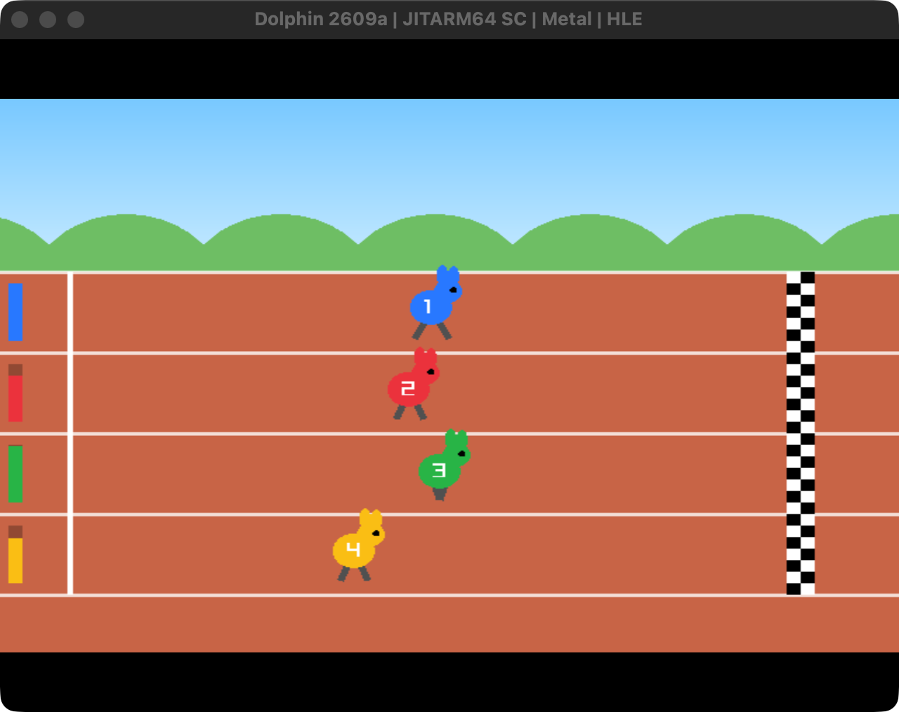
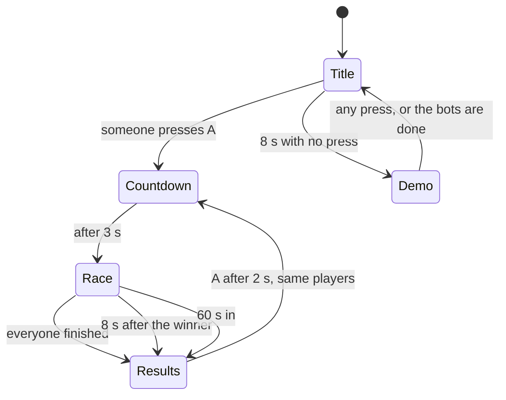

# Shake Race



A running race where the Wiimote is your legs. Everyone gets a lane, and the
harder you shake, the faster your runner goes. Stop shaking and you slow
down. First across the line wins, and the remote gives a long buzz when you
finish first.

**Wear the wrist straps for this one.** It's the game most likely to send a
Wiimote into the TV.

## How to play

1. Start **Shake Race** from the Homebrew Channel.
2. Press **A** to join. Up to four players, one lane each.
3. Wait for **GO!** Shaking during the 3-2-1 does nothing.
4. Shake! The bar at the left of your lane shows how fast you're going.
5. Once someone finishes, everyone else has 8 more seconds. A race also ends
   by itself after 60 seconds, in case everyone stops.
6. The results list everyone in order: finishers by time, the rest by how far
   they got. Press A for a rematch with the same players. Others can still
   join during the countdown.

**HOME** quits. If nobody presses anything on the title for 8 seconds, four
robot runners race in a demo.

## Too hard, or too easy?

The title screen shows the **shake power**, a row of nine bars. Press **+**
for more power, so a gentler shake goes further, or **−** for less. It works
on the title, during the countdown, and on the results screen, but never
during a race. The game saves the level in `settings.txt` next to its
`boot.dol`, so it's remembered next time.

Level 3 is where it starts, and it's the Dolphin tuning. Every two levels up
doubles the speed you get from the same shake, so level 5 is twice as easy
and level 9 is eight times. Level 1 is half. If a race takes much more than
about 15 seconds for the kids, go up a level or two.

## Playing it on the Mac

```sh
bb play:shakerace
```

Left click joins, and **holding the space bar** shakes the remote (so does
the middle mouse button). **Q** is − and **E** is + for the shake
power. Return is HOME. A person hasn't played it this way
yet. The scripted test below shakes through the same Dolphin control, but the
space bar mapping itself is untried.

## How it's built

`examples/shakerace/game.c` is the rules, with 42 checks in
`examples/shakerace/test/test_game.c`. They cover: a still remote doesn't run,
a steady shake settles at the speed the header documents, the speed cap,
slowing down, finishing order, the grace time, the time limit, ties, and
rematches, and that shake power scales the speed (but never moves a still
remote). Another check makes sure shaking on the results screen can't move
a runner who didn't finish. An early version allowed it, so the standings
could change after the race was over.

The screens differ a little from the other two games. The results lead
straight into a rematch, and a race can end three ways:



The speed model, from `game.h`:

- Every frame, a shake above the dead zone (0.25 g) adds speed:
  `speed += 0.5 * power * (shake - 0.25)`, where `power` is 1 at shake power
  level 3 and doubles every two levels.
- Speed drains away at 1.6 per second, and tops out at 15 m/s.
- So steady shaking of `s` g per frame settles at about
  `0.5 * (s - 0.25) * 60 / 1.6` m/s.

Dolphin's scripted shake averages 0.85 g per frame, and its runner finishes
the 100 m in about 10 seconds. How hard a real seven-year-old shakes is the
open question, which is what the shake power setting is for. If a remote
held still creeps forward, the dead zone in `game.h` is the number to raise
instead. [Wiimote input](wiimote-input.md) has the measurements behind
these numbers.

## Ideas for next time

- Hurdles: press A at the right moment to jump.
- Pick your runner: bunny, cat, robot.
- A relay, where two players on a team share a lane.
