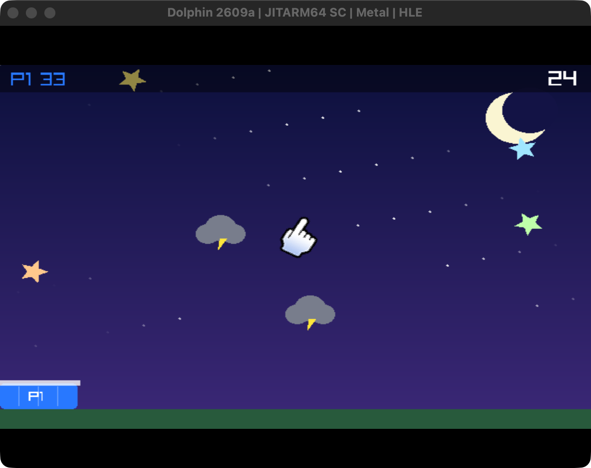

# Star Catcher



Stars fall out of the night sky, and you catch them in a basket by tipping the
Wiimote. Rainbow stars are worth 5. Grey storm clouds don't cost any points,
but catching one makes your basket slow and wobbly for a second and a half,
so it's worth steering round them.

## How to play

1. Start **Star Catcher** from the Homebrew Channel.
2. Hold the Wiimote **sideways**, with the D-pad on your left, the way you'd
   hold an old game pad.
3. Press **2** (or A, or 1) to join. Up to four players, each with a coloured
   basket: blue, red, green, yellow. Anyone can join until the 3-2-1 countdown
   ends, and you can practise steering while it counts.
4. **Tip the remote like a steering wheel** to slide your basket left and
   right. The further you tip, the faster it goes, up to about 30 degrees.
   The D-pad steers too, for anyone who finds tipping hard.
5. Rounds last 60 seconds and the top score wins. Press 2 on the results
   screen to go back to the title.

**HOME** quits. If nobody presses anything on the title for 8 seconds, two
robot baskets play a 20-second demo.

## Basket going the wrong way?

Press **−** on the title screen, during the countdown, or on the results
screen. That flips the steering, and a banner says so. The game saves the
choice in `settings.txt` next to its `boot.dol` on the SD card or USB drive,
so it stays flipped next time. Press − again to flip it back. It doesn't work
during a round, so nobody flips it by accident mid-game.

This is there because the steering direction came from Dolphin, and nobody
has tried it with a real remote yet.

## Playing it on the Mac

```sh
bb play:starcatcher
```

Dolphin's keyboard has no tilt, so on the Mac the arrow keys steer (they're
the Wiimote's D-pad). Left click or the `2` key joins, **Q** is − (flip the steering), and Return
is HOME.

## How it's built

The same split as Balloon Pop. `examples/starcatcher/game.c` holds the rules
and builds on the Mac, where `bb test` runs 48 checks on it: joining,
steering from tilt in both directions, steering speed and the walls, which
items land in a basket, one basket per item, the storm cloud's slow-down, the
round timer, rumble that stops when the round ends, and the demo.
`examples/starcatcher/main.c` turns the Wiimote into a steering value and
draws the night sky.

Steering reads the accelerometer's y axis, the remote's long axis, which is
the one gravity moves along when you tip a sideways remote
(`game_tilt_steer`). The default direction came from Dolphin, and
[Wiimote input](wiimote-input.md) explains why that needs checking on a real
remote. The − button and the saved setting are in `main.c`, using
`examples/common/settings.c`.

## Ideas for next time

- Catch a run of five without dropping one for a bonus.
- Shooting stars that cross the screen sideways.
- A two-player mode where both people share one big basket.
