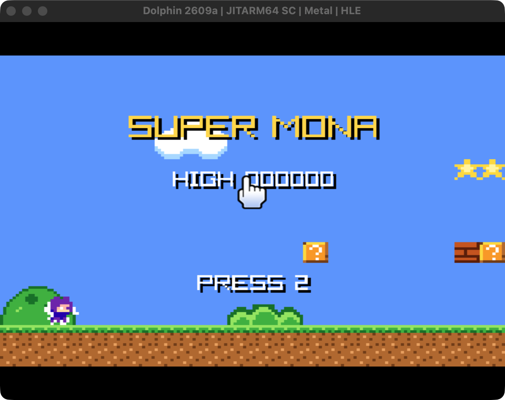
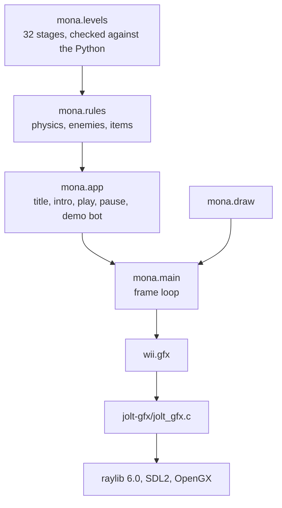

# Super Mona in jolt

Super Mona is a 32-stage platformer that Martin Woodward wrote in MicroPython
for the GitHub Universe 2026 badge. Here it runs on the Wii as a Clojure
program on jolt, with the remote held sideways. It plays, and it misses the
60 fps budget on busy frames. Every number on this page comes from Dolphin with
MMU emulation on. No jolt build has run on a physical console yet, so read
them as Dolphin's, not the Wii's.


| Title | Play |
|---|---|
|  |  |

## Where it came from

The game is [martinwoodward/super-mona](https://github.com/martinwoodward/super-mona)
(MIT). Its README describes eight worlds of four stages, each world shaped like
a classic overworld, underground, sky and castle run:

| World | -1 | -2 | -3 | -4 |
|---|---|---|---|---|
| 1 | HELLO WORLD | SERVER ROOM | SKY BRIDGE | FIREWALL |
| 2 | PULL REQUEST | OVERFLOW | CLOUD DEPLOY | CONFLICT |
| 3 | CLONE | FORK | PUSH | PULL |
| 4 | ACTION | TRIGGER | PRE-PROD | PROD |
| 5 | BUG BASH | STACK TRACE | BREAKPOINT | SEGFAULT |
| 6 | CONTAINER | KERNEL PANIC | EDGE CACHE | DEADLOCK |
| 7 | CLONE | STASH | PR | MERGE |
| 8 | PLAN | BUILD | TEST | SHIP-IT |

We kept the badge's rules and stages and rewrote the code. The physics in
`jolt-mona/src/mona/rules.clj` is transcribed from the badge's `game.py`, and
the 32 stages in `levels.clj` are reproduced from its `levels.py`. The Mona
sprites derive from the badge's Flappy Mona (badger/home, MIT). The
[attribution](#attribution) is at the bottom.

## Playing it on the Wii

Hold the remote sideways, like an NES pad.

| Remote | Action |
|---|---|
| D-pad | Move. Down crouches when Mona is big |
| 2 | Jump. Hold it for a higher jump |
| 1 | Run. Hold to carry a shell, release to throw it |
| + | Pause. Left and Right switch between PAUSED, MAP, ITEMS and HERO |
| Home | Quit |

Whichever remote presses 2 on the title screen drives that game. After a game
ends, any remote can start the next one. The high score is saved as
`mona_high` in `settings.txt` beside `boot.dol`.

```sh
jolt build:jolt-mona
jolt run:jolt-mona            # the title demo plays stage 1-1
jolt run:jolt-mona-wiimote    # a scripted remote: 2 every second, 1 and D-pad down held
jolt play:jolt-mona           # you play with the keyboard
```

`jolt play:jolt-mona` uses the `play-sideways` profile: Left and Right Arrow
move, Up and Down Arrow are the pad's up and down, X is 2, Z is 1, Return is +
and Escape is Home. The profiles are described in
[Wiimote input](wiimote-input.md#scripted-remotes-for-testing).

## How it's built



The game is `jolt-mona/src/mona/{rules,levels,draw,app,main}.clj`. It sits on
the same pipeline as [Balloon Pop in Clojure](balloon-pop-in-clojure.md): the
graphics pack, the shim registered at link time, and one `defcfn` per C
function. Where Balloon Pop uses plain maps, the Mona records have `^double`
fields, because the cast work in that page showed what an unhinted double costs
on 32-bit Chez. The tile grid is a byte array, the one mutable structure in the
game. Everything else is a functional update.

### What the shim gained

The shim in `jolt-gfx/` took three additions, plus a counter.

- **Sprites.** The sprite sheets are embedded as PNG bytes in
  `jolt-gfx/mona_assets.h`, which `scripts/png-to-c` generates from
  `jolt-mona/assets`. `jg_sprite` takes a cell, a position and in-place flips,
  and `jg_scale` multiplies everything by 4, so the badge's small sprites fill
  a TV.
- **Tile layers.** `jg_tiles_load` hands the stage to C once, `jg_tile_set`
  changes one cell (a broken brick, a bumped block), and `jg_tiles_draw` draws
  the visible 23 by 15 window from a buffer on the C side. `jg_tiles_map`
  draws the minimap on the pause MAP page.
- **Settings.** `jg_setting_get` and `jg_setting_put` sit over
  `examples/common/settings.c`. That file now prints integral values exactly,
  where `%g` had cut them off from 1,000,000 up.
- **`jg_calls`** counts shim crossings per frame, so the frame summary can say
  how many a frame needed.

The reason for batching is in the Balloon Pop page: a crossing costs 4 to 18 us
and a write through memory costs more, so one call that draws a whole window
beats hundreds of calls that draw a cell each. The tile window is that batch.

### Build flags and the heap

`jolt build:jolt-mona` needs jolt at or past
[jolt-lang/jolt#1514](https://github.com/jolt-lang/jolt/pull/1514). It builds
with `--closed-world --boot small --no-trace`, passed through
`JOLT_BUILD_FLAGS`. The reason is the heap. A 17.5 MB `.dol` ran out of jolt's
heap at boot, and the 11.9 MB one boots. jolt 0.8.28 made a traced build about
1 MB bigger again (13.06 MB, out of memory at boot), so the build also turns
tracing off, which gives 12.35 MB. A crash report then names fewer frames. The heap arithmetic is in
[Balloon Pop in Clojure](balloon-pop-in-clojure.md#what-this-taught-us-about-jolt).

## What moved and what did not

The badge pre-renders each stage into one big image and scrolls it. OpenGX has
no framebuffer objects, so that image does not exist here. The shim draws a
23 by 15 window of tiles from the C-side buffer every frame instead. The
badge's vector fonts became raylib's default font. The stages, the physics, the
enemies, the items and the pause pages are the badge's.

## Sound

Super Mona has chip-style sound: seventeen effects and ten original tunes,
synthesised in the C shim and played through libogc's AESND. The badge has no
sound to port, so all of it is new. The recording is
[a one-minute Dolphin capture with its audio](../demos/super-mona-sound.mp4),
made by `jolt demo:jolt-mona-video`, which writes `docs/demos/super-mona-sound.mp4`
with the debug stamp hidden. Nothing here has run on the real console yet, so
every claim below is Dolphin's.

### The synthesiser

`jolt-gfx/jolt_snd.c` has seven voices: two pulse and a triangle and a noise
voice for the music, then two pulse voices and a noise voice for effects. Each
voice has an ADSR envelope, and an effect is a short list of frequency slides.
One AESND stream voice at 48 kHz carries the mix. Its callback renders a fixed
288 frames per call from the audio interrupt, using integer maths on static
state only: no allocation, no floats, no calls into Chez.

A four-track sequencer plays the tunes (pulse 1, pulse 2, triangle, and drums
on the noise voice). It can loop, pause on a row, and change tempo from the
next row. The core is plain C99, so `jolt test` builds and checks it with a host
`cc`. The Wii glue sits behind `__wii__`, and `jg_snd_register` in
`jolt_snd.c` registers its exports the same way `register_all` registers the
graphics ones.

### The note language

The tunes are data in `jolt-mona/src/mona/music.clj`. Each pattern is two bars
of 4/4 on 32 rows, and a track is a string of notes, each with an optional `:` and
row count: `g4:2` is G in octave 4 held for two rows, `-` is a rest and a bare
note is one row. Drums are `k`, `s` and `h`. A pattern is a map of its four
tracks, the two pulse voices, the triangle and the noise channel. This is the
first pattern of the title tune:

```clojure
{:p1 [:brass "d4:2 g4:2 d5:4 b4:2 d5:2 g5:4 f#5:3 e5 d5:4 b4:2 e5:2 d5:4"]
 :p2 [:harm "b3:8 d4:8 c4:8 a3:4 f#3:4"]
 :tri [:bass "g2:2 -:2 g2:2 d2:2 g2:2 -:2 g2:2 d2:2 d2:2 -:2 d2:2 a2:2 d2:2 -:2 d2:2 f#2:2"]
 :noise "k - - - s - h - k - k - s - h h k - - - s - h - k - k - s - h h"}
```

A song names its patterns in `:order`, a tempo in rows per minute and the
order index to loop back to. The ten songs are `title`, `day`, `dusk`, `cloud`,
`cave`, `castle`, `clear`, `die`, `over` and `win`.

### From note data to C

`scripts/music-to-c` reads `mona.music` and writes `jolt-gfx/mona_music.h`, the
tables the shim links. The header is committed. A `jolt test` gate regenerates
it and fails when the committed copy is stale, so editing a tune means running
`scripts/music-to-c` and committing both files. The Makefile makes
`jolt_snd.o` depend on the header, so a changed tune rebuilds the shim.

### When things play

`mona.sound` holds the cue rules as pure functions of the app map, and
`mona.main` sends the result to the shim each frame.

- **Title:** the title tune loops. **Intro:** silent. **Over:** the game-over
  tune plays once. **Win:** the win tune loops.
- **Play, pause and demo:** the stage theme's tune loops (`day`, `dusk`,
  `cloud`, `cave` or `castle`). Pause holds the row and releases the voices,
  and resuming picks up at the same row.
- **Hurry-up:** when `time-left` drops under 100 the tempo goes to 125 percent.
- **Death:** the `die` jingle plays once on the die event, and effects stay
  silent while the hero is dying so the jingle owns the sound.
- **Clear:** the `clear` fanfare starts at the flag and keeps going through the
  castle walk and the tally, because the world has a `:castle` state between
  the flag and the tally.
- **Effects:** one per rule event that has a recipe. There are seventeen,
  including `star`, which the first design table missed. The `die` effect is a
  silent step, since the jingle is music.

### The mute toggle

`-` on the title turns the sound off and on, and the title shows `SOUND OFF`
while it is off. The choice is saved as `mona_sound` in `settings.txt`
(`mona_sound=0` is off) and survives a reboot. Muting sets both volumes to 0,
so the synthesiser keeps running and the stats stay comparable.

### The log

The loop prints `sound init=<0|1>` at boot, `sound on` or `sound off` when the
setting is applied, and `music <song|none>` whenever the tune changes. The
300-frame `frames` line gains four fields:

| Field | Meaning |
|---|---|
| `snd-peak` | the largest sample rendered since the last summary |
| `sfx` | effects triggered, saturating at 255 |
| `snd-cb` | stream callbacks run, saturating at 63 |
| `snd-music` | the largest sum of the four music voices, effects excluded |

### Listening

`jolt run:jolt-mona-audio` boots the game in Dolphin with
`-C Dolphin.DSP.DumpAudio=True`, picks the loudest dump and prints its path and
peak. The 48 kHz voice is `dspdump1.wav` under the profile's `Dump/Audio`
(`.dolphin-auto/idle/Dump/Audio`). The plain `dspdump.wav` is Dolphin's silent
32 kHz mixer. `-C Dolphin.Movie.DumpFrames=True` dumps PNG frames, which
`jolt demo:jolt-mona-video` joins with the audio, because this Dolphin build has
no video encoder of its own. `jolt run:jolt-mona-mute` presses `-` on the title
and prints whether the game muted and saved.

### What `jolt verify` checks without a listener

`jolt verify` can't hear anything, so it reads the shim's stats. Three gates
cover sound, and 18 checks pass with them:

- **`jolt-mona-sound`:** in the demo run, `snd-music` is above 3000 in some
  window (music rendered) and `sfx` above 0 (effects triggered).
- **`jolt-mona-sound-wiimote`:** the same two conditions in the scripted-remote
  run, so the rules' events reach the shim from real input.
- **`jolt-mona-mute`:** a run with `-` pressed on the title logs `sound off`
  and saves `mona_sound=0`, and a second boot reads it back and starts muted.

A passing gate proves that samples were rendered, not that they sound good.
The tunes and effects are tuned from the numbers and need an ear on the
console.

### The numbers

Measured on this branch in Dolphin, single runs (`jolt-mona/MEASUREMENTS.md`
has the setup).

| Window | 601-900 | 901-1200 | 1201-1500 | 1501-1800 | 1801-2100 |
|---|---|---|---|---|---|
| Work median before sound (ms) | 15.0 | 14.0 | 12.8 | 11.8 | 10.9 |
| Work median with sound (ms) | 14.8 | 14.8 | 13.2 | 12.2 | 11.3 |

Sound cost between minus 0.2 and plus 0.8 ms a frame in the demo, within the
run-to-run spread of a few tenths. Stage music renders at an `snd-music` of
7304 to 7578 per window. The shim's static footprint is 3,344 bytes of data
plus bss, and the audio dump's loudest peak was 7718 of 32767.

The .dol grew from 11,872,224 to 12,040,896 bytes with sound. That is the
heap's margin: requiring all of `mona.music` on the Wii path made it
12,259,456 bytes and the boot died with "out of memory" before the first line.
So `mona.music` (the note parser and the data) is host-only, and the Wii build
may require only `mona.music-ids`. The margin is under about 240 KB of .dol and
its lower bound is unknown. The shim's `jolt_gfx:` heap line can't show the
headroom: its "fallback ... free 0 + 0" means the fallback heaps were not
built, not that they are empty. A console boot is the real test.

### A deviation from the design

The design promised a per-call render under a budget counted in rendered
frames, and no test checks that. It holds by structure, since each callback
renders a fixed 288 frames, but it is a property of the code and not of a
test.

## The tests

`jolt test` runs four namespaces for the game, all on the Mac under
`jolt -A:test`.

- **`mona.levels-test`** compares every stage byte for byte with a dump of the
  Python. `scripts/mona-golden` makes the dump from the badge's `levels.py`,
  and the result is `golden_levels.edn`. A second test has the demo bot finish
  every one of the 32 stages, at 30 and at 60 Hz.
- **`mona.rules-test`** mirrors the badge's own rule tests: stomping a bug,
  a shell pickup and throw, a held jump going higher, a brick that breaks only
  when Mona is big, 100 stars giving a life, and falling off the stage.
- **`mona.app-test`** walks the title, the intro, play and the pause pages, a
  death and a clear, and the second game started from another remote.
- **`mona.draw-test`** pins the draw calls of recorded states
  (`draw_golden.edn`), including a left-facing player flipped in place.

`jolt verify` also boots the game in Dolphin. It checks the demo, the scripted
jump, and that the loop is still printing frame summaries late in the run.

## The measurements

The game prints one summary line every 300 frames. Work is update plus draw.
Dropped counts frames whose interval ran past 20 ms. Calls is shim crossings
per frame. `jolt-mona/MEASUREMENTS.md` has every window and the setup (jolt
v0.8.23-429, Dolphin, MMU on).

| Run | Window | Work median (ms) | Dropped per 300 | Calls |
|---|---|---|---|---|
| Scripted, first screen | each of 6 windows | 6.5 to 6.6 | 1 to 3 | 28 to 29 |
| Demo, title | frames 1-600 | 6.1 | 1 to 2 | 27 |
| Demo, stage 1-1 | frames 601-900 | 18.2 | 53 | 32 |
| Demo, stage 1-1 | frames 901-1200 | 16.5 | 34 | 33 |
| Demo, stage 1-1 | frames 1201-1500 | 12.8 | 2 | 31 |
| Demo, stage 1-1 | frames 1501-1800 | 7.7 | 1 | 28 |

Play on the first screen costs 6.5 ms of work a frame. The demo bot goes
deeper into stage 1-1, where more enemies are alive, and the update alone takes
12.9 ms in its worst window against 2.9 ms in its lightest. Drawing is flat at
4 to 5 ms everywhere, title screen included, and 28 to 32 crossings a frame
cannot account for that. The tile window in C is the likelier cost, though only a run with the stub-draw
pack would split the two.

The spec's bar was a work median of 12 ms with no work frame over 16.7 ms. The
scripted run passes the median and the demo misses it in four of its
windows. Both fail the worst-frame limit, because every run shows stalls of
280 to 850 ms. A run with jolt's collector log on (`scripts/dkp make -C jolt-gfx EXTRA_CFLAGS=-DJG_GC_LOG`)
shows 28 collections in 45 s, none of them full, the longest 10 ms and 29 ms in
total (two of them before `jg_init`), so the stalls are not the collector. One
6 ms collection sits inside the first stall, none inside the others. They fall
on start-up and the first title frames and on the two stage loads (23.153 s and
46.193 s, from that run's log and not kept in the extract).

### The fallback ladder

The ladder is in order, and which rung to climb is the user's decision. No
rung has been tried yet.

| Rung | What | State |
|---|---|---|
| 0 | An algorithmic fix in Clojure for the enemy update, which scans linearly and rebuilds vectors per enemy, so it is O(N^2) | Not done |
| 0b | The collector: measured with `JOLT_GC_LOG`, 29 ms over a 45 s run and no stall inside it, so its options (static boot data, less allocation per frame, a forced collection in the intro) are moot for the stalls | Measured |
| 1 | Batched sprite calls | Not done, buys little |
| 2 | Enemy and item physics in C | Not done |
| 3 | The renderer in C | Not done |

## Attribution

`jolt-mona/assets` and the game's rules and stages come from Super Mona by
Martin Woodward, MIT license
([github.com/martinwoodward/super-mona](https://github.com/martinwoodward/super-mona)),
ported from MicroPython to Clojure. The Mona sprites derive from the badge's
Flappy Mona (badger/home, MIT). The MIT copyright and permission notice is in
`jolt-mona/LICENSE.super-mona`, and `NOTICE` at the root of the repository
carries the same credit.
