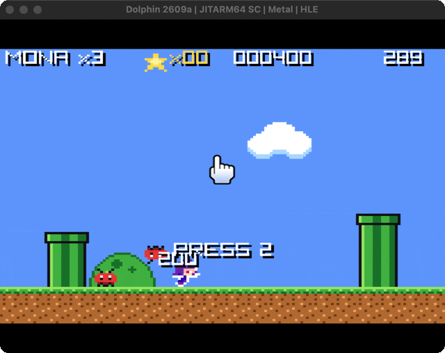
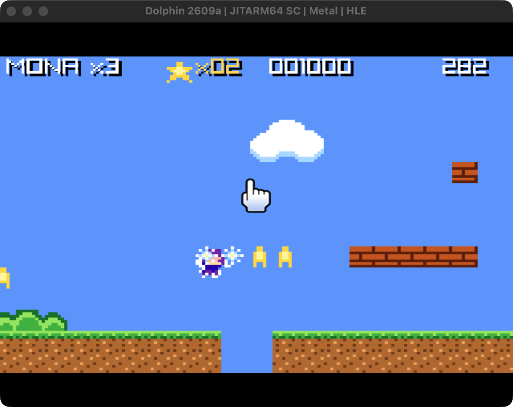
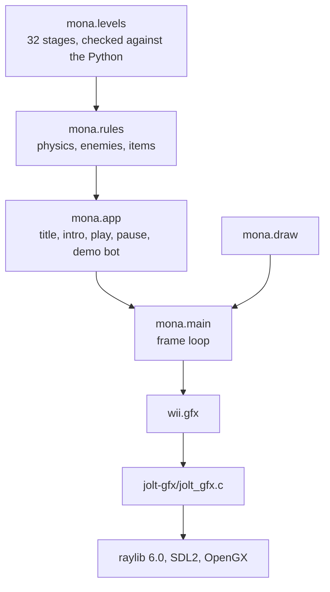

# Super Mona in jolt

Super Mona is a 32-stage platformer that Martin Woodward wrote in MicroPython
for the GitHub Universe 2026 badge. Here it runs on the Wii as a Clojure
program on jolt, with the remote held sideways. It plays, and it misses the
60 fps budget on busy frames. Every number on this page comes from Dolphin with
MMU emulation on. Nothing has run on a physical console, so read them as
Dolphin's, not the Wii's.



| Title | Play |
|---|---|
|  |  |

## Where it came from

The game is [martinwoodward/super-mona](https://github.com/martinwoodward/super-mona)
(MIT). Its README describes eight worlds of four stages, each world shaped like
a classic overworld, underground, sky and castle run:

| World | -1 | -2 | -3 | -4 |
|---|---|---|---|---|
| 1 | HELLO WORLD | SERVER ROOM | SKY BRIDGE | FIREWALL |
| 2 | PULL REQUEST | OVERFLOW | CLOUD DEPLOY | CONFLICT |
| 3 | CLONE | FORK | PUSH | PULL |
| 4 | ACTION | TRIGGER | PRE-PROD | PROD |
| 5 | BUG BASH | STACK TRACE | BREAKPOINT | SEGFAULT |
| 6 | CONTAINER | KERNEL PANIC | EDGE CACHE | DEADLOCK |
| 7 | CLONE | STASH | PR | MERGE |
| 8 | PLAN | BUILD | TEST | SHIP-IT |

We kept the badge's rules and stages and rewrote the code. The physics in
`jolt-mona/src/mona/rules.clj` is transcribed from the badge's `game.py`, and
the 32 stages in `levels.clj` are reproduced from its `levels.py`. The Mona
sprites derive from the badge's Flappy Mona (badger/home, MIT). The
[attribution](#attribution) is at the bottom.

## Playing it on the Wii

Hold the remote sideways, like an NES pad.

| Remote | Action |
|---|---|
| D-pad | Move. Down crouches when Mona is big |
| 2 | Jump. Hold it for a higher jump |
| 1 | Run. Hold to carry a shell, release to throw it |
| + | Pause. Left and Right switch between PAUSED, MAP, ITEMS and HERO |
| Home | Quit |

Whichever remote presses 2 on the title screen drives that game. After a game
ends, any remote can start the next one. The high score is saved as
`mona_high` in `settings.txt` beside `boot.dol`.

```sh
bb build:jolt-mona
bb run:jolt-mona            # the title demo plays stage 1-1
bb run:jolt-mona-wiimote    # a scripted remote: 2 every second, 1 and D-pad down held
bb play:jolt-mona           # you play with the keyboard
```

`bb play:jolt-mona` uses the `play-sideways` profile: Left and Right Arrow
move, Up and Down Arrow are the pad's up and down, X is 2, Z is 1, Return is +
and Escape is Home. The profiles are described in
[Wiimote input](wiimote-input.md#scripted-remotes-for-testing).

## How it's built



The game is `jolt-mona/src/mona/{rules,levels,draw,app,main}.clj`. It sits on
the same pipeline as [Balloon Pop in Clojure](balloon-pop-in-clojure.md): the
graphics pack, the shim registered at link time, and one `defcfn` per C
function. Where Balloon Pop uses plain maps, the Mona records have `^double`
fields, because the cast work in that page showed what an unhinted double costs
on 32-bit Chez. The tile grid is a byte array, the one mutable structure in the
game. Everything else is a functional update.

### What the shim gained

The shim in `jolt-gfx/` took three additions, plus a counter.

- **Sprites.** The sprite sheets are embedded as PNG bytes in
  `jolt-gfx/mona_assets.h`, which `scripts/png-to-c` generates from
  `jolt-mona/assets`. `jg_sprite` takes a cell, a position and in-place flips,
  and `jg_scale` multiplies everything by 4, so the badge's small sprites fill
  a TV.
- **Tile layers.** `jg_tiles_load` hands the stage to C once, `jg_tile_set`
  changes one cell (a broken brick, a bumped block), and `jg_tiles_draw` draws
  the visible 23 by 15 window from a buffer on the C side. `jg_tiles_map`
  draws the minimap on the pause MAP page.
- **Settings.** `jg_setting_get` and `jg_setting_put` sit over
  `examples/common/settings.c`. That file now prints integral values exactly,
  where `%g` had cut them off from 1,000,000 up.
- **`jg_calls`** counts shim crossings per frame, so the frame summary can say
  how many a frame needed.

The reason for batching is in the Balloon Pop page: a crossing costs 4 to 18 us
and a write through memory costs more, so one call that draws a whole window
beats hundreds of calls that draw a cell each. The tile window is that batch.

### Build flags and the heap

`bb build:jolt-mona` needs jolt at or past
[jolt-lang/jolt#1514](https://github.com/jolt-lang/jolt/pull/1514). It builds
with `--closed-world --boot small`, passed through `JOLT_BUILD_FLAGS`. The
reason is the heap. A 17.5 MB `.dol` ran out of jolt's heap at boot, and the
11.9 MB one boots. The heap arithmetic is in
[Balloon Pop in Clojure](balloon-pop-in-clojure.md#what-this-taught-us-about-jolt).

## What moved and what did not

The badge pre-renders each stage into one big image and scrolls it. OpenGX has
no framebuffer objects, so that image does not exist here. The shim draws a
23 by 15 window of tiles from the C-side buffer every frame instead. The
badge's vector fonts became raylib's default font. The stages, the physics, the
enemies, the items and the pause pages are the badge's.

## The tests

`bb test` runs four namespaces for the game, all on the Mac under
`jolt -A:test`.

- **`mona.levels-test`** compares every stage byte for byte with a dump of the
  Python. `scripts/mona-golden` makes the dump from the badge's `levels.py`,
  and the result is `golden_levels.edn`. A second test has the demo bot finish
  every one of the 32 stages, at 30 and at 60 Hz.
- **`mona.rules-test`** mirrors the badge's own rule tests: stomping a bug,
  a shell pickup and throw, a held jump going higher, a brick that breaks only
  when Mona is big, 100 stars giving a life, and falling off the stage.
- **`mona.app-test`** walks the title, the intro, play and the pause pages, a
  death and a clear, and the second game started from another remote.
- **`mona.draw-test`** pins the draw calls of recorded states
  (`draw_golden.edn`), including a left-facing player flipped in place.

`bb verify` also boots the game in Dolphin. It checks the demo, the scripted
jump, and that the loop is still printing frame summaries late in the run.

## The measurements

The game prints one summary line every 300 frames. Work is update plus draw.
Dropped counts frames whose interval ran past 20 ms. Calls is shim crossings
per frame. `jolt-mona/MEASUREMENTS.md` has every window and the setup (jolt
v0.8.23-429, Dolphin, MMU on).

| Run | Window | Work median (ms) | Dropped per 300 | Calls |
|---|---|---|---|---|
| Scripted, first screen | each of 6 windows | 6.5 to 6.6 | 1 to 3 | 28 to 29 |
| Demo, title | frames 1-600 | 6.1 | 1 to 2 | 27 |
| Demo, stage 1-1 | frames 601-900 | 18.2 | 53 | 32 |
| Demo, stage 1-1 | frames 901-1200 | 16.5 | 34 | 33 |
| Demo, stage 1-1 | frames 1201-1500 | 12.8 | 2 | 31 |
| Demo, stage 1-1 | frames 1501-1800 | 7.7 | 1 | 28 |

Play on the first screen costs 6.5 ms of work a frame. The demo bot goes
deeper into stage 1-1, where more enemies are alive, and the update alone takes
12.9 ms in its worst window against 2.9 ms in its lightest. Drawing is flat at
4 to 5 ms everywhere, title screen included, and 28 to 32 crossings a frame
cannot account for that. The tile window in C is the likelier cost, though only a run with the stub-draw
pack would split the two.

The spec's bar was a work median of 12 ms with no work frame over 16.7 ms. The
scripted run passes the median and the demo misses it in four of its
windows. Both fail the worst-frame limit, because every run shows a stall of
280 to 340 ms every few seconds. We think it is the runtime's periodic
collection of the older generation, but that is not confirmed.

### The fallback ladder

The ladder is in order, and which rung to climb is the user's decision. No
rung has been tried yet.

| Rung | What | State |
|---|---|---|
| 0 | An algorithmic fix in Clojure for the enemy update, which scans linearly and rebuilds vectors per enemy, so it is O(N^2) | Not done |
| 0b | The collector: confirm with `JOLT_GC_LOG=1`, then static boot data, less allocation per frame, or a forced major collection during the intro | Not done |
| 1 | Batched sprite calls | Not done, buys little |
| 2 | Enemy and item physics in C | Not done |
| 3 | The renderer in C | Not done |

## Attribution

`jolt-mona/assets` and the game's rules and stages come from Super Mona by
Martin Woodward, MIT license
([github.com/martinwoodward/super-mona](https://github.com/martinwoodward/super-mona)),
ported from MicroPython to Clojure. The Mona sprites derive from the badge's
Flappy Mona (badger/home, MIT). `NOTICE` at the root of the repository carries
the same line.
