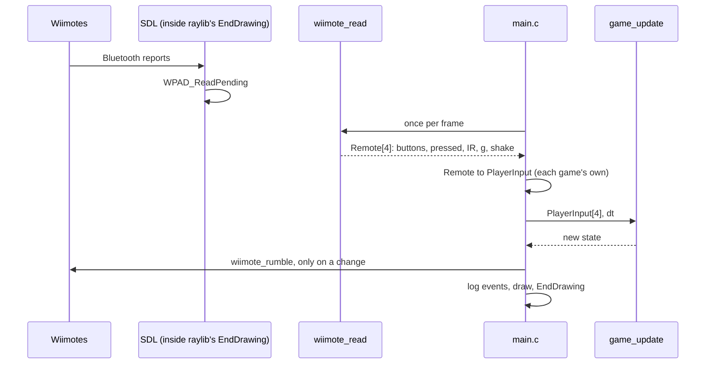
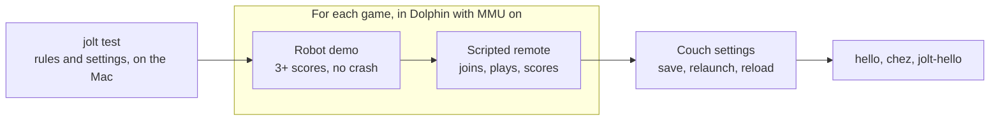
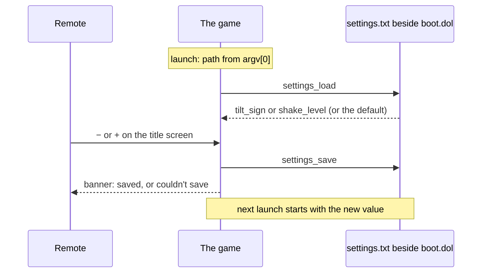

# Wiimote input

All three games read the remotes through one small module,
`examples/common/wiimote.{h,c}`. This page covers what it gives a game, the
numbers we measured for tilt and shake, and how `jolt verify` plays each game
with a scripted remote.

## The module

SDL's Wii port folds every remote's IR pointer into a single mouse, which is
no good for four players. So the games read libogc's WPAD directly:

```c
wiimote_init(SCREEN_W, SCREEN_H);   // buttons + accelerometer + IR, IR in screen pixels

Remote r[WIIMOTE_MAX];
if (wiimote_read(r)) break;         // once a frame; true when anyone pressed HOME
// r[p].connected, .held, .pressed, .ir_valid, .ir_x, .ir_y, .gx, .gy, .gz, .shake

wiimote_rumble(p, on);              // only talks to the remote when it changes
```

One frame, from the remote to the screen:



`pressed` is "held now, not held last frame", worked out from `btns_h`, so a
press that lands between two reads isn't lost. `shake` is how far the
acceleration moved since the last frame, `|g_now - g_before|` in g, and it's
zero on the first frame after a remote connects.

Each game turns a `Remote` into its own small input struct (`PlayerInput`),
so the rules in `game.c` never see a Wii header and the tests can feed them
anything.

One thing every app needs, module or not: `#include <SDL2/SDL_main.h>` in
`main.c`. SDL's own `main` is what calls `WPAD_Init`, and without it every
remote reads as disconnected. [Balloon Pop](balloon-pop.md) tells how we found
that.

## Tilt: what Dolphin reports

We booted a throwaway probe in Dolphin that printed `gforce` for each
scripted pose:

| Pose in Dolphin | gx | gy | gz |
|---|---|---|---|
| at rest, flat | 0.00 | 0.00 | 1.00 |
| upright, "tilt right" | 1.00 | 0.00 | 0.08 |
| sideways, "tilt right" | 0.00 | -1.00 | 0.08 |

So for a sideways remote, steering lives on `gy`, and in Dolphin tipping
right makes it negative. Star Catcher steers with `-gy` by default
(`TILT_SIGN_DEFAULT` and `game_tilt_steer` in its `game.h`/`game.c`), full
speed at 0.5 g (about 30 degrees), with a 0.1 g dead zone.

Our own reasoning about the accelerometer's axes said the opposite sign.
Dolphin wins for now, because Wii games are tested against it. But this is
the first thing to try on the console. If the basket goes the wrong way,
press − on the title screen to flip it (see Couch settings below).

## Shake: what Dolphin reports

The same probe, with Dolphin shaking the remote on all three axes for 1 s in
every 2 s, averaged over 2-second windows:

| | per-frame `shake` |
|---|---|
| held still (tilt runs) | 0.04 to 0.09 |
| shaking, peak | 2.45 |
| shaking, mean over 2 s | 0.85, with 62 of 120 frames over 0.25 |

That's where Shake Race's 0.25 g dead zone comes from: well above a
still remote, well below a shake. A real remote's noise, and how hard a
child really shakes, are both still unmeasured.

## The sideways remote

Super Mona holds the remote sideways, like an NES pad, so the buttons map
differently from the other games:

| Remote | Action |
|---|---|
| D-pad | Move. Down crouches when Mona is big |
| 2 | Jump. Hold for a higher jump |
| 1 | Run. Hold to carry a shell, release to throw it |
| + | Pause. Left and Right switch between PAUSED, MAP, ITEMS and HERO |
| Home | Quit |

The remote that presses 2 on the title drives that game. See
[Super Mona in jolt](super-mona-in-jolt.md).

## Scripted remotes for testing

`scripts/dolphin-auto-wiimote <profile>` writes a Dolphin user directory under
`.dolphin-auto/<profile>/` whose Wiimote 1 plays by itself, through Dolphin's
input expressions:

| Profile | Used by | What the remote does |
|---|---|---|
| `pointer` | Balloon Pop | A four times a second; IR sweeps left and right every 5 s |
| `tilt` | Star Catcher | A four times a second; held sideways, tipped about 70 degrees each way every 4 s |
| `shake` | Shake Race | A four times a second; shaken 1 s in every 2 |
| `minus`, `plus` | the couch check | one press of − or +, 3.4 to 4 s after start |
| `idle` | the couch check | connected, presses nothing |
| `platformer` | Super Mona | held sideways: 2 pressed every second, with 1 and D-pad down held |
| `play-sideways` | `jolt play:jolt-mona` | nothing scripted: Left and Right Arrow move, Up and Down Arrow are the pad's up and down, X is 2, Z is 1, Return is +, Escape is Home |
| `play` | `jolt play:*` | nothing scripted: Dolphin's mouse and keyboard defaults (Q is −, E is +), plus Space to shake |

`jolt verify` boots each game twice, once to watch the robot demo and once with
its scripted remote, and requires the remote to join, the round to start, and
player 1 to score during it.



## Couch settings

Two numbers in these games came from Dolphin, not from real remotes: Star
Catcher's steering direction and Shake Race's shake strength. So both can be
changed from the remote, without a rebuild. In Star Catcher, − flips the
steering. In Shake Race, + and − set the shake power. Neither works during a
round.

Both games also read `sound` from the same file. `sound=0` mutes the game, and
any other value, or no line at all, leaves it on. There is no button for it, so
edit `settings.txt` on the SD card.

`examples/common/settings.c` keeps the choice in `settings.txt` beside the
game's `boot.dol`. The Homebrew Channel launches a game with `argv[0]` set to
its path (`usb:/apps/starcatcher/boot.dol`), and SDL's `main` passes it
through and mounts the SD card and USB drive (`fatInitDefault`). Without a
path (Dolphin passes `"app"`) it falls back to `sd:/apps/<game>/`. If the file
can't be written, the banner says so instead of claiming it saved. Integral
values are saved exactly (the old `%g` format cut them off from 1,000,000 up),
and `jolt-mona` keeps its high score there as `mona_high`.

`jolt verify` checks each setting end to end (`jolt run:couch` runs just that).
Dolphin builds an emulated SD card from a folder on the Mac, `.work/sd-couch`,
and copies it back on shutdown:

```sh
-C Dolphin.Core.WiiSDCard=True -C Dolphin.Core.WiiSDCardEnableFolderSync=True
-C Dolphin.General.WiiSDCardSyncFolder=<folder> -C Dolphin.Core.WiiSDCardAllowWrites=True
```



The check presses the button once, requires `saved=1` in the log and the
right line in the folder's `settings.txt`, then boots again with no presses
and requires the game to start with the new value. `jolt play:*` uses the same
trick with `.work/sd-play`, so settings stick between sessions on the Mac.

Two traps from writing these:

- **A bare number is a key name.** `Tilt/Right = 1` does nothing, because
  Dolphin reads `1` as the 1 key. A constant has to be an expression, such as
  `sin(1.5708)`.
- **Dolphin ignores input when its window isn't focused.** Every control
  expression, timer-based or not, reads 0 unless the game window has focus
  (`UpdateInputGate` in Dolphin's `Core.cpp`). Whether a test run got focus
  depended on what else was on the Mac's screen, so a scripted remote would
  sometimes never join, or join and then stop. `scripts/dolphin-shot` now
  passes `-C Dolphin.Input.BackgroundInput=True`. Shake Race failed 2 of its
  first 4 scripted runs before that and passed 3 of 3 after.
- **Background input also hears the Mac.** Once it was on, the robot-demo
  runs, which still used Dolphin's default profile (mouse and keyboard),
  started picking up clicks and key presses from whoever was using the Mac.
  Any press ends a demo, so all three demo checks failed in one `jolt verify`.
  Every unscripted run now uses the `idle` profile, a remote with nothing
  bound, and only `jolt play:*` binds the Mac's mouse and keyboard.
